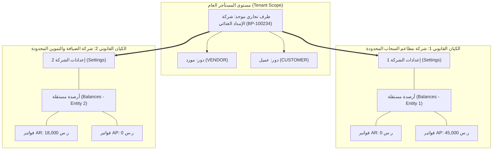
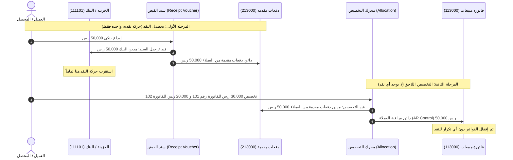
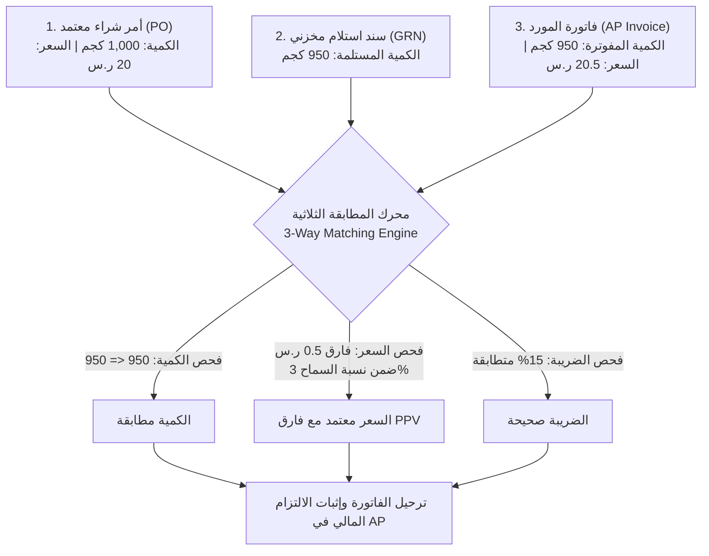

# Restaurant Cloud — Business Partners & AR/AP Architecture Study
## دراسة معمارية وتصميم وظيفي وتقني متكامل لسجل الأطراف الموحد والدفاتر المساعدة للعملاء والموردين

**تاريخ الدراسة والتحديث النهائي:** 9 نوفمبر 2026  
**الإصدار المعماري:** 2.0.0 (Enterprise Architecture Master Specification)  
**الحالة:** دراسة معمارية نهائية معتمدة للتنفيذ المباشر (Final Architecture Approved for Execution)  
**النظام المستهدف:** Restaurant Cloud — Core Financial & Accounting Engine

---

## الفهرس العام

1. [الملخص التنفيذي وأهداف الوحدة](#1-الملخص-التنفيذي-وأهداف-الوحدة)
2. [دليل ومطابقة شجرة الحسابات الفعلية وحسابات الخصومات والضرائب](#2-دليل-ومطابقة-شجرة-الحسابات-الفعلية-وحسابات-الخصومات-والضرائب)
3. [معمارية تعدد الشركات والاستقلال القانوني الصارم (Multi-Entity Architecture)](#3-معمارية-تعدد-الشركات-والاستقلال-القانوني-الصارم-multi-entity-architecture)
4. [إعادة تصميم دورة النقد وسندات القبض والصرف والتخصيص المستقل](#4-إعادة-تصميم-دورة-النقد-وسندات-القبض-والصرف-والتخصيص-المستقل)
5. [دورة المشتريات المتكاملة والمطابقة الثلاثية 3-Way Matching](#5-دورة-المشتريات-المتكاملة-والمطابقة-الثلاثية-3-way-matching)
6. [الامتثال الضريبي السعودي لفواتير وإشعارات ZATCA القياسية (B2B Tax Invoices)](#6-الامتثال-الضريبي-السعودي-لفواتير-وإشعارات-zatca-القياسية-b2b-tax-invoices)
7. [نموذج البيانات ومخطط العلاقات المطور (Enhanced ERD Diagram)](#7-نموذج-البيانات-ومخطط-العلاقات-المطور-enhanced-erd-diagram)
8. [تصميم الجداول والقيود والفهارس والمفاتيح المركبة (Database DDL Specification)](#8-تصميم-الجداول-والقيود-والفهارس-والمفاتيح-المركبة-database-ddl-specification)
9. [قواعد الترحيل المحاسبي ودفتر الأستاذ العام (Posting Engine Specifications)](#9-قواعد-الترحيل-المحاسبي-ودفتر-الأستاذ-العام-posting-engine-specifications)
10. [محرك تخصيص الدفعات والتسويات والعكس (Allocation & Reversal Engine)](#10-محرك-تخصيص-الدفعات-والتسويات-والعكس-allocation--reversal-engine)
11. [الأمان والحماية التزامنية ومقاومة السباق (Concurrency & Row-Level Security)](#11-الأمان-والحماية-التزامنية-ومقاومة-السباق-concurrency--row-level-security)
12. [مصفوفة الصلاحيات والحوكمة (RBAC & Governance Matrix)](#12-مصفوفة-الصلاحيات-والحوكمة-rbac--governance-matrix)
13. [تصميم واجهات المستخدم وتجربة الاستخدام (UI/UX Specifications)](#13-تصميم-واجهات-المستخدم-وتجربة-الاستخدام-uiux-specifications)
14. [محرك التقارير المالية والتحليلية ومطابقة منع الانحراف (Zero-Drift Reporting)](#14-محرك-التقارير-المالية-والتحليلية-ومطابقة-منع-الانحراف-zero-drift-reporting)
15. [معايير القبول ومصفوفة الاختبارات التفصيلية (Acceptance Criteria & Test Matrix)](#15-معايير-القبول-ومصفوفة-الاختبارات-التفصيلية-acceptance-criteria--test-matrix)

---

## 1. الملخص التنفيذي وأهداف الوحدة

تمثل وحدة **الأطراف التجارية والدفاتر المساعدة (Business Partners, Accounts Receivable & Accounts Payable)** الركيزة المالية والتشغيلية لمنظومة Restaurant Cloud للمطاعم والمنشآت التجارية المتعددة الفروع والشركات القانونية.

### الأهداف المحورية للتصميم المعتمد:
1. **سجل هوية موحد على مستوى المستأجر (Unified Party Master per Tenant):** إلغاء الازدواجية بتعريف الطرف التجاري ككيان قانوني واحد (`Business Partner`) يتبع للمستأجر ويحمل رقماً تعريفياً ثابتاً، مع تمكينه من ممارسة أدوار متعددة (`Roles: Customer, Vendor, Employee, Broker`) في الشركات التابعة لنفس المجموعة دون تكرار.
2. **استقلال مالي وقانوني صارم لكل شركة (Strict Legal Entity Decoupling):** فواتير، وسندات، وأرصدة، وحدود ائتمان، وشروط سداد مستقلة تماماً لكل شركة قانونية (`Legal Entity`). يُمنع اختلاط أرصدة أو معاملات الشركات منعاً قاطعاً بضمانات قيود تكامل مرجعي مركبة (Composite Foreign Keys) على مستوى قاعدة البيانات.
3. **فصل دورة النقد عن دورة التخصيص (Decoupled Cash Flow & Allocation):**
   - تسجيل حركة النقد والبنوك يحدث **مرة واحدة فقط** عند إصدار وترحيل سند القبض أو الصرف.
   - تخصيص السند لاحقاً على الفواتير المستحقة يُعالج عبر حسابات وسيطة/دفعات مقدمة **ولا يعيد تحريك النقدية إطلاقاً**.
   - دعم التخصيص الجزئي، والتخصيص المتعدد، والدفعات المقدمة المستقلة، وعكس التخصيص (Unmatch) دون المساس بالنقد المقبوض أو المصروف.
4. **المطابقة الثلاثية لدورة المشتريات (3-Way Matching Procurement Engine):** مطابقة حتمية بين أمر الشراء (PO)، وسند استلام المخزون (GRN)، وفاتورة المورد (AP Invoice)، مع معالجة الاستلام الجزئي، والاستلام غير المفوتر (GRNI)، والفواتير بدون استلام مسبق، وحساب فروق الأسعار (PPV).
5. **مطابقة تامة مع شجرة الحسابات الفعلية وتوحيد الخصومات (Strict COA Alignment):** مواءمة جميع رموز الحسابات المحاسبية مع شجرة الحسابات المعتمدة فعلياً في النظام، وتوحيد معالجة الخصومات التجارية والخصومات المالية المكتسبة والمسموح بها وفروق العملات.
6. **الامتثال التام لمتطلبات الفوترة الإلكترونية ZATCA (Phase 2 B2B Compliance):** توليد فواتير وإشعارات دائنة ومدينة قياسية مستوفية لجميع عناصر الهوية الضريبية للعميل، مع الربط الإلزامي للإشعارات بالفواتير الأصلية عبر معرّف الـ UUID وتاريخ ورقم الفاتورة الأصلية ومطابقة سلسلة التجزئة (Hash Chaining).
7. **منع الانحراف المحاسبي نهائياً (Zero Subledger-to-GL Drift):** حظر أي قيد مباشر على حسابات المراقبة بدون تحديد الطرف التجاري ودوره، وتوفير شاشة تسوية فورية تكشف أي انحراف فور حدوثه.

---

## 2. دليل ومطابقة شجرة الحسابات الفعلية وحسابات الخصومات والضرائب

تعتمد هذه المعمارية حصرياً على شجرة الحسابات الفعلية المطبقة في قاعدة بيانات Restaurant Cloud، وتمنع افتراض أي رموز غير موجودة أو غير مسجلة رسمياً.

### 2.1 مصفوفة الحسابات المالية المعتمدة للدفاتر المساعدة

| رمز الحساب | اسم الحساب في النظام | التصنيف المحاسبي | الطبيعة | وظيفة الحساب ودوره في الدفاتر المساعدة |
| :---: | :--- | :---: | :---: | :--- |
| **`111000`** | الصناديق والخزائن النقدية (رئيسي) | ASSET | مدين | حساب تجميعي لمراكز النقدية والخزائن التشغيلية |
| **`111001`** | خزينة الإدارة العامة (الرئيسية) | ASSET | مدين | الخزينة النقدية المركزية لتحصيلات وسندات الإدارة |
| **`111002`** | خزينة فرع الرياض (العليا) | ASSET | مدين | خزانة الفرع التشغيلية لتحصيل وسداد الفروع |
| **`111100`** | الحسابات البنكية الجارية (رئيسي) | ASSET | مدين | حساب تجميعي للبنوك والتحويلات المصرفية |
| **`111101`** | بنك الراجحي - الحساب التشغيلي | ASSET | مدين | بنك الصرف والتحصيل والتحويلات لنقاط البيع والفواتير |
| **`112000`** | مخزون المواد الغذائية والمستودعات | ASSET | مدين | حساب أصول المخزون المستلم بالأسعار المعيارية/الفعلية |
| **`112900`** | بضاعة بالطريق / مشتريات قيد الاستلام | ASSET | مدين | حساب وسيط في حالة الفوترة المسبقة قبل الاستلام الفعلي |
| **`113000`** | مراقبة الذمم المدينة (العملاء - AR Control) | ASSET | مدين | **حساب مراقبة محمي:** يحظر القيد اليدوي بدون عميل معتمد |
| **`114000`** | ضريبة القيمة المضافة المدفوعة (مدخلات) | ASSET | مدين | ضريبة الـ 15% القابلة للخصم من فواتير الموردين والمشتريات |
| **`115000`** | دفعات مقدمة للموردين (Vendor Prepayments) | ASSET | مدين | أصل مالي يثبت مبالغ سددت للموردين قبل استلام الفواتير |
| **`116000`** | جاري الشركات الشقيقة - مدين (Due from Related) | ASSET | مدين | تسوية التحصيلات والسدادات العابرة بين الشركات التابعة |
| **`211000`** | مراقبة الذمم الدائنة (الموردين - AP Control) | LIABILITY | دائن | **حساب مراقبة محمي:** يحظر القيد اليدوي بدون مورد معتمد |
| **`212000`** | ضريبة القيمة المضافة المستحقة (مخرجات) | LIABILITY | دائن | ضريبة الـ 15% المحصلة لصالح هيئة الزكاة على المبيعات |
| **`213000`** | دفعات مقدمة من العملاء (Customer Advances) | LIABILITY | دائن | التزام يثبت نقدية مستلمة من العملاء قبل إصدار الفواتير |
| **`214000`** | بضاعة مستلمة غير مفوترة (GRNI Clearing) | LIABILITY | دائن | حساب وسيط لإثبات استلام المخزون (GRN) بانتظار فاتورة المورد |
| **`216000`** | جاري الشركات الشقيقة - دائن (Due to Related) | LIABILITY | دائن | تسوية التزامات السداد نيابة عن شركات شقيقة |
| **`411000`** | إيرادات مبيعات المطاعم والضيافة | REVENUE | دائن | إيرادات المبيعات التشغيلية الآجلة والنقدية |
| **`412000`** | خصم مسموح به (تعجيل دفع للعملاء) | CONTRA-REV | مدين | تخفيض الإيرادات عند استفادة العميل من خصم السداد النقدي |
| **`413000`** | مردودات ومسموحات المبيعات | CONTRA-REV | مدين | إثبات المرتجعات بموجب الإشعارات الدائنة الضريبية |
| **`422000`** | خصم مكتسب على المشتريات (Earned Discounts) | REVENUE / INC | دائن | إيراد/تخفيض تكلفة ناتج عن سداد الموردين مبكراً |
| **`423000`** | أرباح فروقات أسعار صرف العملات المحققة | REVENUE / INC | دائن | ناتجة عن تسوية فواتير العملات الأجنبية بسعر صرف أعلى |
| **`511000`** | تكلفة البضاعة المباعة (COGS) | EXPENSE | مدين | تكلفة المخزون المنصرف للتشغيل والمبيعات |
| **`512000`** | فروقات وتوالف الجرد المخزني | EXPENSE | مدين | إثبات الفروقات الناتجة عن تسويات الجرد الدوري والمفاجئ |
| **`514000`** | فروقات أسعار الشراء (Purchase Price Variance) | EXPENSE / ADJ | مدين/دائن | الفارق بين سعر أمر الشراء وسعر فاتورة المورد المعتمدة |
| **`523000`** | خسائر فروقات أسعار صرف العملات المحققة | EXPENSE | مدين | ناتجة عن تسوية فواتير العملات الأجنبية بسعر صرف أدنى |

### 2.2 القواعد المحاسبية الصارمة للخصومات وفروق العملات
1. **الخصم التجاري (Trade Discount):** يظهر مباشرة في سطور الفاتورة قبل الضريبة ويخفض قيمة الفاتورة الصادرة ولا ينشأ له حساب مستقل في الأستاذ العام؛ إذ تسجل الفاتورة بالصافي بعد الخصم التجاري وفق المعيار المحاسبي الدولي IFRS 15.
2. **الخصم المالي / خصم تعجيل السداد المسموح به (Cash Discount Allowed):** يمنحه المطعم للعميل عند السداد المبكر خلال المهلة؛ ويسجل كحساب مقابل للإيرادات (`412000 - CONTRA-REVENUE`) يظهر مطروحاً من إجمالي الإيرادات في قائمة الدخل.
3. **الخصم المالي المكتسب (Cash Discount Earned):** يكتسبه المطعم عند سداد فواتير الموردين مبكراً؛ ويسجل في حساب (`422000 - Earned Discounts`) كبند تخفيض تكلفة تشغيلية أو إيراد تشغيلي آخر.
4. **فروق العملات الأجنبية (Realized FX Gain/Loss):**
   - في حال كان سعر الصرف وقت السداد/التخصيص مختلفاً عن سعر الصرف وقت إصدار الفاتورة:
     - فارق إيجابي للمنشأة $\rightarrow$ دائن: حساب أرباح فروق العملات (`423000`).
     - فارق سلبي على المنشأة $\rightarrow$ مدين: حساب خسائر فروق العملات (`523000`).
   - يُقفل حساب المراقبة (`113000` أو `211000`) بكامل القيمة الوظيفية للفاتورة لمنع أي ترحيل معلق.

---

## 3. معمارية تعدد الشركات والاستقلال القانوني الصارم (Multi-Entity Architecture)

تم تصميم المنظومة لتخدم المجموعات والشركات القابضة المالكة لعدة علامات تجارية وكيانات قانونية مستقلة داخل نفس النظام السحابي.

### 3.1 فصل سجل الطرف عن الإعدادات المالية للشركة


### 3.2 قواعد الحوكمة المؤسسية لتعدد الشركات:
1. **وحدة السجل المركزي:** يُسجل الطرف مرة واحدة على مستوى المستأجر (`tenant_id`) برقم ضريبي موحد ورقم سجل تجاري وهوية قانونية واحدة.
2. **استقلال السياسات المالية (`partner_company_settings`):**
   - تخصص لكل شركة قانونية (`legal_entity_id`) شروط دفع مستقلة (مثلاً: نقدي فوري في شركة التموين، بينما 45 يوماً في شركة المطاعم).
   - حد الائتمان مستقل لكل شركة؛ تجاوز العميل للحد في الشركة (1) لا يوقفه آلياً في الشركة (2) إلا إذا تم تفعيل خيار الحظر الشامل (`Global Tenant Hold`).
3. **أرصدة منفصلة لكل شركة وعملة (`partner_balances`):**
   - المفتاح الفريد لسجل الرصيد: `(tenant_id, legal_entity_id, partner_id, currency)`.
   - لا يمكن رياضياً أو برمجياً إجراء مقاصة بين مديونية العميل في شركة ودائنيته في شركة أخرى تابعة لنفس المستأجر إلا من خلال معاملة تسوية رسمية عابرة للشركات (Intercompany Netting) عبر حسابات جاري الشركات الشقيقة (`116000` / `216000`).
4. **حظر التخصيص العابر للشركات (Cross-Company Allocation Rejection):**
   - قيود الربط المرجعي المركب (Composite Foreign Keys) تمنع بشكل قاطع استخدام سند قبض أو صرف صادر من الشركة (أ) لسداد أو إغلاق فاتورة تابعة للشركة (ب).

---

## 4. إعادة تصميم دورة النقد وسندات القبض والصرف والتخصيص المستقل

عالج هذا التصميم الخلل المعماري الشائع المتمثل في تكرار تسجيل حركة النقد عند التخصيص، وفصل دورة حركة الخزينة/البنك عن دورة تسوية ومطابقة الفواتير تماماً.

### 4.1 المبادئ المعمارية الحتمية
1. **تسجيل النقد يتم مرة واحدة فقط وبصورة نهائية:** حركة الخزائن والبنوك تثبت في الأستاذ العام فقط وحصرياً عند ترحيل سند القبض (`Receipt Voucher`) أو سند الصرف (`Payment Voucher`).
2. **التخصيص لا يحرك النقد إطلاقاً:** جدول التخصيص (`ar_receipt_allocations` / `ap_payment_allocations`) يربط مستندين ماليين مرحلين مسبقاً، وقيده المحاسبي يقتصر على تسوية حسابات المراقبة وحسابات الدفعات المقدمة والخصومات وفروق العملة دون لمس حسابات النقدية (`111000` / `111100`).
3. **استقلالية الدفعات المقدمة (Prepayments Independence):** أي دفعة غير مخصصة تسجل مباشرة في حسابات الدفعات المقدمة (`213000 - Customer Advances` للعملاء، أو `115000 - Vendor Prepayments` للموردين) وتظهر في كشف الحساب كرصيد معلق جاهز للتخصيص اللاحق.
4. **دعم التخصيص الجزئي والمتعدد:**
   - سند واحد يخصص لسداد عدة فواتير كاملة أو جزئية.
   - فاتورة واحدة تسدد بعدة سندات وإشعارات دائنة.
5. **إمكانية التعديل والعكس (Reversal & Unmatch):**
   - السند أو التخصيص غير المرحل (`DRAFT`) يمكن تعديله أو حذفه بحرية.
   - التخصيص المرحل (`POSTED`) يُلغى حصرياً عبر عملية **عكس تخصيص (Unmatch Allocation)** تنشئ قيداً عكسياً يعيد فتح الفاتورة المستحقة ويعيد المبلغ كرصيد غير مخصص بالسند، دون أي تأثير على رصيد البنك أو الخزينة.

### 4.2 مخطط دورة النقد والتخصيص المستقل


---

## 5. دورة المشتريات المتكاملة والمطابقة الثلاثية 3-Way Matching

تقدم هذه المعمارية دورة متكاملة للمشتريات تمنع سداد فواتير غير مستلمة أو غير معتمدة وتضمن ضبط المخزون والتكاليف.

### 5.1 أطراف المطابقة الثلاثية
1. **أمر الشراء المعتمد (Approved Purchase Order - PO):** يحدد الأصناف والكميات المتفق عليها وأسعار الشراء المعتمدة وشروط التسليم.
2. **سند استلام البضاعة (Goods Receipt Note - GRN):** يثبت استلام أمين المستودع للكميات الفعلية بعد الفحص المخبري والظاهري.
3. **فاتورة المورد الضريبية (AP Vendor Invoice):** الفاتورة المستلمة من المورد للمطالبة المالية.



### 5.2 معالجة الحالات الاستثنائية لعمليات التوريد
1. **الاستلام الجزئي (Partial Receipt):**
   - إذا استلم المستودع `600 كجم` من أصل `1,000 كجم`:
     - يُنشأ سند استلام (GRN) بـ `600 كجم`.
     - يُسمح فقط بفوترة `600 كجم` بجدول `ap_invoices`.
     - يظل أمر الشراء مفتوحاً بحالة `PARTIALLY_RECEIVED` للكمية المتبقية (`400 كجم`).
2. **الاستلام دون فاتورة (Goods Received Not Invoiced - GRNI):**
   - عند استلام المخزون دون وصول الفاتورة:
     - ينشأ قيد المخزون الفوري:
       - مدين: مخزون المواد الغذائية والمستودعات (`112000`)
       - دائن: حساب وسيط البضاعة المستلمة غير المفوترة (GRNI Clearing - `214000`)
   - عند استلام الفاتورة لاحقاً:
     - ينشأ قيد استحقاق الفاتورة وتصفير الحساب الوسيط:
       - مدين: حساب وسيط البضاعة المستلمة غير المفوترة (`214000`) [إقفال الوسيط]
       - مدين: ضريبة القيمة المضافة المدفوعة (مدخلات - `114000`)
       - دائن: مراقبة الذمم الدائنة - الموردين (AP Control - `211000`)
3. **الفاتورة المسبقة دون استلام (Pre-billed Invoicing):**
   - في الحالات الاستثنائية المعتمدة (مثل الشحنات الخارجية المدفوعة مقدماً):
     - لا تُرحل الفاتورة مباشرة للمخزون، بل تسجل بحساب وسيط:
       - مدين: بضاعة بالطريق / مشتريات قيد الاستلام (`112900`)
       - مدين: ضريبة المدخلات المعلقة (`114000`)
       - دائن: مراقبة الموردين (AP Control - `211000`)
     - وعند وصول البضاعة للمستودع وإصدار الـ GRN:
       - مدين: مخزون المواد الغذائية (`112000`)
       - دائن: بضاعة بالطريق / مشتريات قيد الاستلام (`112900`) [تصفير الوسيط]
4. **فروقات أسعار الشراء (Purchase Price Variance - PPV):**
   - إذا تجاوز سعر الفاتورة سعر أمر الشراء ضمن نسبة التسامح المعتمدة في إعدادات الشركة (`price_tolerance_pct` e.g., $\le 2\%$):
     - يُقيد الفرق في حساب فروقات أسعار الشراء (`514000 - PPV`).
   - إذا تجاوزت نسبة السماح:
     - تُحظر الفاتورة وتتحول لحالة `PRICE_HOLD` وتتطلب موافقة مدير المشتريات والمدير المالي، أو يطلب من المورد تصحيح الفاتورة بإشعار دائن.

---

## 6. الامتثال الضريبي السعودي لفواتير وإشعارات ZATCA القياسية (B2B Tax Invoices)

تم تصميم دفاتر AR لتتوافق تماماً مع اشتراطات هيئة الزكاة والضريبة والجمارك (ZATCA Phase 2 - Integration Phase) للفواتير الضريبية القياسية بين المنشآت (B2B).

### 6.1 المتطلبات الإلزامية لبيانات العميل في الفاتورة القياسية
1. **الاسم القانوني للعميل:** مسجل في `business_partners.legal_name_ar`.
2. **الرقم الضريبي للعميل (VAT/TRN):** رقم مكون من 15 خانة يبدأ بالرقم 3 وينتهي بالرقم 3، ويتم التحقق من صحته عبر خوارزمية التحقق الرسمية.
3. **رقم السجل التجاري (CRN):** مكون من 10 أرقام في `commercial_registration_number`.
4. **العنوان الوطني السعودي التفصيلي (Saudi National Address):**
   - رقم المبنى (`building_number`) مكون من 4 أرقام.
   - اسم الشارع (`street_name`).
   - اسم الحي (`district_name`).
   - اسم المدينة (`city`).
   - الرمز البريدي (`postal_code`) مكون من 5 أرقام.
   - الرقم الإضافي (`additional_number`) مكون من 4 أرقام.
   - كود الدولة (`country_code = 'SA'`).

### 6.2 متطلبات الإشعارات الدائنة والمدينة (Credit & Debit Notes)
- يُمنع إصدار أي إشعار دائن أو مدين في النظام دون ربطه بالفاتورة الأصلية.
- **الحقول الإلزامية لربط الإشعار بالفاتورة الأصلية:**
  - معرّف الفاتورة الأصلية الداخلي (`original_invoice_id`).
  - معرّف الـ UUID الفريد للفاتورة الأصلية (`original_invoice_uuid`).
  - رقم الفاتورة الأصلية المرجعي (`original_invoice_number`).
  - تاريخ إصدار الفاتورة الأصلية (`original_invoice_date`).
  - كود سبب إصدار الإشعار وفق تصنيف ZATCA المعتمد (`zatca_reason_code`):
    - `01`: إلغاء الفاتورة بالكامل (Cancellation).
    - `02`: مردودات بضاعة كلية أو جزئية (Goods Return).
    - `03`: تعديل أو تخفيض في الأسعار (Price Adjustment / Commercial Discount).
    - `04`: تصحيح خطأ مادي في البيانات (Data Correction).
- **سلسلة التجزئة المشفرة (Hash Chaining):**
  - كل فاتورة أو إشعار يحسب له كود تجزئة مشفر (SHA-256 Hash) يعتمد على بيانات الفاتورة الحالية والـ Hash للفاتورة السابقة لها في نفس المنشأة (`previous_invoice_hash`).

---

## 7. نموذج البيانات ومخطط العلاقات المطور (Enhanced ERD Diagram)

```mermaid
erDiagram
    TENANTS ||--o{ BUSINESS_PARTNERS : owns
    TENANTS ||--o{ LEGAL_ENTITIES : owns
    LEGAL_ENTITIES ||--o{ BRANCHES : operates
    LEGAL_ENTITIES ||--o{ WAREHOUSES : operates
    LEGAL_ENTITIES ||--o{ CHART_OF_ACCOUNTS : owns
    
    BUSINESS_PARTNERS ||--o{ PARTNER_ROLES : holds
    BUSINESS_PARTNERS ||--o{ PARTNER_ADDRESSES : locates
    BUSINESS_PARTNERS ||--o{ PARTNER_CONTACTS : contacts
    
    BUSINESS_PARTNERS ||--o{ PARTNER_COMPANY_SETTINGS : configures
    LEGAL_ENTITIES ||--o{ PARTNER_COMPANY_SETTINGS : applies_to
    
    BUSINESS_PARTNERS ||--o{ PARTNER_BALANCES : tracks
    LEGAL_ENTITIES ||--o{ PARTNER_BALANCES : owns

    LEGAL_ENTITIES ||--o{ AR_INVOICES : issues
    BUSINESS_PARTNERS ||--o{ AR_INVOICES : billed_to
    AR_INVOICES ||--o{ AR_INVOICE_LINES : contains
    AR_INVOICES ||--o{ AR_RECEIPT_ALLOCATIONS : cleared_by
    RECEIPT_VOUCHERS ||--o{ AR_RECEIPT_ALLOCATIONS : funds
    
    LEGAL_ENTITIES ||--o{ AP_INVOICES : receives
    BUSINESS_PARTNERS ||--o{ AP_INVOICES : billed_from
    AP_INVOICES ||--o{ AP_INVOICE_LINES : contains
    AP_INVOICES ||--o{ AP_PAYMENT_ALLOCATIONS : cleared_by
    PAYMENT_VOUCHERS ||--o{ AP_PAYMENT_ALLOCATIONS : funds

    PURCHASE_ORDERS ||--o{ GOODS_RECEIPTS : generates
    GOODS_RECEIPTS ||--o{ AP_INVOICES : matches
    PURCHASE_ORDERS ||--o{ AP_INVOICES : matches

    JOURNAL_ENTRIES ||--o{ JOURNAL_LINES : contains
    BUSINESS_PARTNERS ||--o{ JOURNAL_LINES : subledger_reference
    CHART_OF_ACCOUNTS ||--o{ JOURNAL_LINES : classifies
```



---

## 8. تصميم الجداول والقيود والفهارس والمفاتيح المركبة (Database DDL Specification)

تم بناء الـ DDL التالي بضمانات قيود مرجعية مركبة (Composite Foreign Keys) تفرض على مستوى النواة مطابقة `tenant_id` و `legal_entity_id` بين جميع المستندات والأطراف المرتبطة.

### 8.1 جدول سجل الأطراف التجاري الموحد (`business_partners`)
```sql
CREATE TABLE business_partners (
    id UUID PRIMARY KEY DEFAULT gen_random_uuid(),
    tenant_id UUID NOT NULL REFERENCES tenants(id) ON DELETE RESTRICT,
    partner_number VARCHAR(50) NOT NULL,
    partner_type VARCHAR(20) NOT NULL DEFAULT 'CORPORATE', -- 'CORPORATE' | 'INDIVIDUAL'
    legal_name_ar VARCHAR(255) NOT NULL,
    legal_name_en VARCHAR(255),
    trade_name_ar VARCHAR(255),
    trade_name_en VARCHAR(255),
    tax_identification_number VARCHAR(15), -- الرقم الضريبي السعودي (15 رقم يبدأ وينتهي بـ 3)
    commercial_registration_number VARCHAR(10), -- رقم السجل التجاري (10 أرقام)
    national_id_or_iqama VARCHAR(20), -- للهويات الفردية
    primary_email VARCHAR(255),
    primary_phone VARCHAR(50),
    website VARCHAR(255),
    is_active BOOLEAN NOT NULL DEFAULT true,
    is_on_hold BOOLEAN NOT NULL DEFAULT false,
    hold_reason TEXT,
    notes TEXT,
    created_at TIMESTAMPTZ NOT NULL DEFAULT now(),
    updated_at TIMESTAMPTZ NOT NULL DEFAULT now(),
    created_by UUID,
    updated_by UUID,
    
    -- قيد مركب فريد لدعم الربط المرجعي المركب مع الجداول التابعة
    CONSTRAINT uq_bp_tenant_id UNIQUE (id, tenant_id)
);

CREATE INDEX idx_bp_tenant_id ON business_partners (tenant_id);
CREATE UNIQUE INDEX idx_bp_tenant_number ON business_partners (tenant_id, partner_number);
CREATE UNIQUE INDEX idx_bp_tenant_tax_id ON business_partners (tenant_id, tax_identification_number) 
    WHERE tax_identification_number IS NOT NULL AND tax_identification_number <> '';
CREATE UNIQUE INDEX idx_bp_tenant_crn ON business_partners (tenant_id, commercial_registration_number) 
    WHERE commercial_registration_number IS NOT NULL AND commercial_registration_number <> '';
```

### 8.2 جدول أدوار الأطراف (`partner_roles`)
```sql
CREATE TABLE partner_roles (
    id UUID PRIMARY KEY DEFAULT gen_random_uuid(),
    tenant_id UUID NOT NULL,
    partner_id UUID NOT NULL,
    role_type VARCHAR(30) NOT NULL, -- 'CUSTOMER' | 'VENDOR' | 'EMPLOYEE' | 'BROKER'
    status VARCHAR(20) NOT NULL DEFAULT 'ACTIVE',
    effective_from DATE NOT NULL DEFAULT CURRENT_DATE,
    effective_to DATE,
    created_at TIMESTAMPTZ NOT NULL DEFAULT now(),
    
    CONSTRAINT fk_partner_roles_bp FOREIGN KEY (partner_id, tenant_id) 
        REFERENCES business_partners(id, tenant_id) ON DELETE CASCADE,
    CONSTRAINT uq_partner_role_unique UNIQUE (partner_id, role_type)
);

CREATE INDEX idx_partner_roles_lookup ON partner_roles (tenant_id, role_type, status);
```

### 8.3 جدول عناوين الأطراف الوطنية والدولية (`partner_addresses`)
```sql
CREATE TABLE partner_addresses (
    id UUID PRIMARY KEY DEFAULT gen_random_uuid(),
    tenant_id UUID NOT NULL,
    partner_id UUID NOT NULL,
    address_type VARCHAR(30) NOT NULL DEFAULT 'NATIONAL_ADDRESS', -- 'NATIONAL_ADDRESS' | 'BILLING' | 'SHIPPING' | 'BRANCH_SITE'
    building_number VARCHAR(10) NOT NULL, -- رقم المبنى (4 أرقام إلزامية لـ ZATCA)
    street_name VARCHAR(255) NOT NULL,
    district_name VARCHAR(100) NOT NULL,
    city VARCHAR(100) NOT NULL,
    postal_code VARCHAR(20) NOT NULL, -- الرمز البريدي (5 أرقام إلزامية)
    additional_number VARCHAR(10), -- الرقم الإضافي (4 أرقام)
    country_code VARCHAR(3) NOT NULL DEFAULT 'SA',
    short_address VARCHAR(20), -- e.g. "RRRD2929"
    is_primary BOOLEAN NOT NULL DEFAULT false,
    created_at TIMESTAMPTZ NOT NULL DEFAULT now(),
    
    CONSTRAINT fk_partner_address_bp FOREIGN KEY (partner_id, tenant_id) 
        REFERENCES business_partners(id, tenant_id) ON DELETE CASCADE
);

CREATE INDEX idx_partner_addresses_partner ON partner_addresses (partner_id);
```

### 8.4 جدول إعدادات الطرف للشركة القانونية (`partner_company_settings`)
```sql
CREATE TABLE partner_company_settings (
    id UUID PRIMARY KEY DEFAULT gen_random_uuid(),
    tenant_id UUID NOT NULL,
    legal_entity_id UUID NOT NULL REFERENCES legal_entities(id) ON DELETE RESTRICT,
    partner_id UUID NOT NULL,
    default_currency VARCHAR(3) NOT NULL DEFAULT 'SAR',
    payment_terms_days INTEGER NOT NULL DEFAULT 30, -- 0 = نقد فوري
    credit_limit NUMERIC(14, 4) NOT NULL DEFAULT 0.0000,
    is_credit_blocked BOOLEAN NOT NULL DEFAULT false,
    price_tolerance_pct NUMERIC(5, 4) NOT NULL DEFAULT 0.0200, -- 2% نسبة السماح لفروق الأسعار
    ar_control_account_id UUID REFERENCES chart_of_accounts(id),
    ap_control_account_id UUID REFERENCES chart_of_accounts(id),
    custom_discount_pct NUMERIC(5, 4) NOT NULL DEFAULT 0.0000,
    price_tier_id UUID,
    tax_exempt BOOLEAN NOT NULL DEFAULT false,
    tax_exemption_reason TEXT,
    created_at TIMESTAMPTZ NOT NULL DEFAULT now(),
    updated_at TIMESTAMPTZ NOT NULL DEFAULT now(),
    
    CONSTRAINT fk_partner_company_bp FOREIGN KEY (partner_id, tenant_id) 
        REFERENCES business_partners(id, tenant_id) ON DELETE CASCADE,
    CONSTRAINT uq_partner_company_unique UNIQUE (legal_entity_id, partner_id),
    CONSTRAINT uq_partner_company_ref UNIQUE (id, legal_entity_id, tenant_id)
);
```

### 8.5 جدول الأرصدة اللحظية المستقلة لكل شركة وعملة (`partner_balances`)
```sql
CREATE TABLE partner_balances (
    id UUID PRIMARY KEY DEFAULT gen_random_uuid(),
    tenant_id UUID NOT NULL,
    legal_entity_id UUID NOT NULL REFERENCES legal_entities(id) ON DELETE RESTRICT,
    partner_id UUID NOT NULL,
    currency VARCHAR(3) NOT NULL DEFAULT 'SAR',
    customer_balance NUMERIC(14, 4) NOT NULL DEFAULT 0.0000, -- مدين: ما يدين به العميل للشركة
    customer_unallocated_receipts NUMERIC(14, 4) NOT NULL DEFAULT 0.0000, -- دفعات مقدمة من العميل
    vendor_balance NUMERIC(14, 4) NOT NULL DEFAULT 0.0000, -- دائن: ما تدين به الشركة للمورد
    vendor_unallocated_payments NUMERIC(14, 4) NOT NULL DEFAULT 0.0000, -- دفعات مقدمة للمورد
    last_transaction_at TIMESTAMPTZ NOT NULL DEFAULT now(),
    updated_at TIMESTAMPTZ NOT NULL DEFAULT now(),
    
    CONSTRAINT fk_partner_balances_bp FOREIGN KEY (partner_id, tenant_id) 
        REFERENCES business_partners(id, tenant_id) ON DELETE CASCADE,
    CONSTRAINT uq_partner_balance_entity_partner UNIQUE (legal_entity_id, partner_id, currency)
);
```

### 8.6 جدول فواتير المبيعات بالدفتر المساعد للعملاء (`ar_invoices`)
```sql
CREATE TABLE ar_invoices (
    id UUID PRIMARY KEY DEFAULT gen_random_uuid(),
    tenant_id UUID NOT NULL,
    legal_entity_id UUID NOT NULL REFERENCES legal_entities(id) ON DELETE RESTRICT,
    branch_id UUID REFERENCES branches(id) ON DELETE RESTRICT,
    partner_id UUID NOT NULL,
    invoice_number VARCHAR(50) NOT NULL,
    invoice_type VARCHAR(30) NOT NULL DEFAULT 'TAX_INVOICE', -- 'TAX_INVOICE' | 'CREDIT_NOTE' | 'DEBIT_NOTE'
    original_invoice_id UUID REFERENCES ar_invoices(id),
    original_invoice_uuid VARCHAR(100), -- للامتثال لمتطلبات ZATCA
    original_invoice_number VARCHAR(50),
    original_invoice_date DATE,
    zatca_reason_code VARCHAR(10), -- سبب الإشعار المعتمد من ZATCA
    status VARCHAR(30) NOT NULL DEFAULT 'DRAFT', -- 'DRAFT' | 'POSTED' | 'PARTIALLY_PAID' | 'PAID' | 'CANCELLED'
    issue_date DATE NOT NULL DEFAULT CURRENT_DATE,
    due_date DATE NOT NULL,
    currency VARCHAR(3) NOT NULL DEFAULT 'SAR',
    exchange_rate NUMERIC(12, 6) NOT NULL DEFAULT 1.000000,
    subtotal NUMERIC(14, 4) NOT NULL DEFAULT 0.0000,
    discount_amount NUMERIC(14, 4) NOT NULL DEFAULT 0.0000, -- الخصم التجاري
    taxable_amount NUMERIC(14, 4) NOT NULL DEFAULT 0.0000,
    tax_amount NUMERIC(14, 4) NOT NULL DEFAULT 0.0000,
    grand_total NUMERIC(14, 4) NOT NULL DEFAULT 0.0000,
    paid_amount NUMERIC(14, 4) NOT NULL DEFAULT 0.0000,
    remaining_amount NUMERIC(14, 4) NOT NULL DEFAULT 0.0000,
    journal_entry_id UUID REFERENCES journal_entries(id),
    zatca_uuid VARCHAR(100),
    zatca_hash VARCHAR(255),
    previous_invoice_hash VARCHAR(255),
    notes TEXT,
    created_at TIMESTAMPTZ NOT NULL DEFAULT now(),
    created_by UUID,
    
    CONSTRAINT fk_ar_invoices_bp FOREIGN KEY (partner_id, tenant_id) 
        REFERENCES business_partners(id, tenant_id) ON DELETE RESTRICT,
    CONSTRAINT uq_ar_invoices_ref UNIQUE (id, legal_entity_id, tenant_id),
    CONSTRAINT uq_ar_invoices_number UNIQUE (legal_entity_id, invoice_number)
);

CREATE INDEX idx_ar_invoices_entity_status ON ar_invoices (legal_entity_id, status);
CREATE INDEX idx_ar_invoices_partner ON ar_invoices (partner_id, status);
```

### 8.7 جدول تخصيص المقبوضات على الفواتير (`ar_receipt_allocations`)
```sql
CREATE TABLE ar_receipt_allocations (
    id UUID PRIMARY KEY DEFAULT gen_random_uuid(),
    tenant_id UUID NOT NULL,
    legal_entity_id UUID NOT NULL,
    receipt_voucher_id UUID NOT NULL,
    invoice_id UUID NOT NULL,
    allocated_amount NUMERIC(14, 4) NOT NULL, -- المبلغ المسدد للفاتورة
    discount_amount NUMERIC(14, 4) NOT NULL DEFAULT 0.0000, -- خصم تعجيل السداد المسموح به (412000)
    fx_gain_loss NUMERIC(14, 4) NOT NULL DEFAULT 0.0000, -- فروق العملة المحققة
    allocation_date DATE NOT NULL DEFAULT CURRENT_DATE,
    status VARCHAR(30) NOT NULL DEFAULT 'POSTED', -- 'DRAFT' | 'POSTED' | 'REVERSED'
    reversal_of_id UUID REFERENCES ar_receipt_allocations(id),
    journal_entry_id UUID REFERENCES journal_entries(id),
    created_at TIMESTAMPTZ NOT NULL DEFAULT now(),
    created_by UUID,
    
    -- ضمانات القيود المرجعية المركبة لمنع خلط الشركات والمستأجرين
    CONSTRAINT fk_ar_alloc_invoice FOREIGN KEY (invoice_id, legal_entity_id, tenant_id) 
        REFERENCES ar_invoices(id, legal_entity_id, tenant_id) ON DELETE RESTRICT
);

CREATE INDEX idx_ar_alloc_voucher ON ar_receipt_allocations (receipt_voucher_id);
CREATE INDEX idx_ar_alloc_invoice ON ar_receipt_allocations (invoice_id);
```

### 8.8 جدول فواتير المشتريات بالدفتر المساعد للموردين (`ap_invoices`)
```sql
CREATE TABLE ap_invoices (
    id UUID PRIMARY KEY DEFAULT gen_random_uuid(),
    tenant_id UUID NOT NULL,
    legal_entity_id UUID NOT NULL REFERENCES legal_entities(id) ON DELETE RESTRICT,
    branch_id UUID REFERENCES branches(id) ON DELETE RESTRICT,
    warehouse_id UUID REFERENCES warehouses(id) ON DELETE RESTRICT,
    partner_id UUID NOT NULL,
    supplier_invoice_number VARCHAR(100) NOT NULL,
    internal_number VARCHAR(50) NOT NULL,
    invoice_type VARCHAR(30) NOT NULL DEFAULT 'STANDARD', -- 'STANDARD' | 'DEBIT_NOTE' | 'CREDIT_NOTE'
    original_invoice_id UUID REFERENCES ap_invoices(id),
    status VARCHAR(30) NOT NULL DEFAULT 'DRAFT', -- 'DRAFT' | 'MATCHED' | 'PRICE_HOLD' | 'POSTED' | 'PARTIALLY_PAID' | 'PAID' | 'CANCELLED'
    purchase_order_id UUID REFERENCES purchase_orders(id) ON DELETE RESTRICT,
    goods_receipt_id UUID REFERENCES goods_receipts(id) ON DELETE RESTRICT,
    matching_status VARCHAR(30) NOT NULL DEFAULT 'UNMATCHED', -- 'UNMATCHED' | 'MATCHED_EXACT' | 'MATCHED_WITH_VARIANCE'
    invoice_date DATE NOT NULL,
    due_date DATE NOT NULL,
    currency VARCHAR(3) NOT NULL DEFAULT 'SAR',
    exchange_rate NUMERIC(12, 6) NOT NULL DEFAULT 1.000000,
    subtotal NUMERIC(14, 4) NOT NULL DEFAULT 0.0000,
    price_variance_amount NUMERIC(14, 4) NOT NULL DEFAULT 0.0000, -- فرق السعر PPV
    tax_amount NUMERIC(14, 4) NOT NULL DEFAULT 0.0000,
    grand_total NUMERIC(14, 4) NOT NULL DEFAULT 0.0000,
    paid_amount NUMERIC(14, 4) NOT NULL DEFAULT 0.0000,
    remaining_amount NUMERIC(14, 4) NOT NULL DEFAULT 0.0000,
    journal_entry_id UUID REFERENCES journal_entries(id),
    notes TEXT,
    created_at TIMESTAMPTZ NOT NULL DEFAULT now(),
    created_by UUID,
    
    CONSTRAINT fk_ap_invoices_bp FOREIGN KEY (partner_id, tenant_id) 
        REFERENCES business_partners(id, tenant_id) ON DELETE RESTRICT,
    CONSTRAINT uq_ap_invoices_ref UNIQUE (id, legal_entity_id, tenant_id),
    CONSTRAINT uq_ap_invoices_supplier_doc UNIQUE (legal_entity_id, partner_id, supplier_invoice_number)
);

CREATE INDEX idx_ap_invoices_entity_status ON ap_invoices (legal_entity_id, status);
CREATE INDEX idx_ap_invoices_partner ON ap_invoices (partner_id, status);
```

### 8.9 جدول تخصيص المدفوعات على فواتير المشتريات (`ap_payment_allocations`)
```sql
CREATE TABLE ap_payment_allocations (
    id UUID PRIMARY KEY DEFAULT gen_random_uuid(),
    tenant_id UUID NOT NULL,
    legal_entity_id UUID NOT NULL,
    payment_voucher_id UUID NOT NULL,
    invoice_id UUID NOT NULL,
    allocated_amount NUMERIC(14, 4) NOT NULL,
    discount_amount NUMERIC(14, 4) NOT NULL DEFAULT 0.0000, -- خصم مكتسب (422000)
    fx_gain_loss NUMERIC(14, 4) NOT NULL DEFAULT 0.0000,
    allocation_date DATE NOT NULL DEFAULT CURRENT_DATE,
    status VARCHAR(30) NOT NULL DEFAULT 'POSTED',
    reversal_of_id UUID REFERENCES ap_payment_allocations(id),
    journal_entry_id UUID REFERENCES journal_entries(id),
    created_at TIMESTAMPTZ NOT NULL DEFAULT now(),
    created_by UUID,
    
    CONSTRAINT fk_ap_alloc_invoice FOREIGN KEY (invoice_id, legal_entity_id, tenant_id) 
        REFERENCES ap_invoices(id, legal_entity_id, tenant_id) ON DELETE RESTRICT
);

CREATE INDEX idx_ap_alloc_voucher ON ap_payment_allocations (payment_voucher_id);
CREATE INDEX idx_ap_alloc_invoice ON ap_payment_allocations (invoice_id);
```

### 8.10 تحديث جدول سطور القيود اليومية (`journal_lines`)
```sql
-- إضافة الأعمدة اللازمة للربط التام بالدفاتر المساعدة ومنع الانحراف
ALTER TABLE journal_lines ADD COLUMN IF NOT EXISTS partner_id UUID REFERENCES business_partners(id);
ALTER TABLE journal_lines ADD COLUMN IF NOT EXISTS partner_role VARCHAR(20); -- 'CUSTOMER' | 'VENDOR'
ALTER TABLE journal_lines ADD COLUMN IF NOT EXISTS subledger_document_type VARCHAR(30); -- 'AR_INVOICE' | 'AP_INVOICE' | 'ALLOCATION'
ALTER TABLE journal_lines ADD COLUMN IF NOT EXISTS subledger_document_id UUID;

CREATE INDEX IF NOT EXISTS idx_journal_lines_partner ON journal_lines (tenant_id, partner_id);
```

---

## 9. قواعد الترحيل المحاسبي ودفتر الأستاذ العام (Posting Engine Specifications)

يوضح هذا القسم بدقة مطلقة القيود المزدوجة المتوازنة الناتجة عن كل حركة، ويؤكد على عدم تكرار حركة النقد إطلاقاً.

### 9.1 قيود دورة الذمم المدينة والمبيعات (AR Cycles)

#### الحالة 1: إصدار وترحيل فاتورة مبيعات آجلة (B2B Tax Invoice)
- **المعطيات:** مبيعات بـ `10,000 ر.س` + ضريبة 15% (`1,500 ر.س`) = الإجمالي `11,500 ر.س`.
```
[القيد المحاسبي المزدوج]:
من حـ/ مراقبة الذمم المدينة - العملاء (AR Control - 113000) [معرف العميل إلزامياً]   11,500 مدين
      إلى حـ/ إيرادات مبيعات المطاعم والضيافة (Sales Revenue - 411000)                     10,000 دائن
      إلى حـ/ ضريبة القيمة المضافة المستحقة (Output VAT - 212000)                            1,500 دائن
```

#### الحالة 2: إصدار وترحيل سند قبض بنكي (Receipt Voucher) — تسجيل النقد الوحيد
- **المعطيات:** استلام تحويل بنكي بـ `11,500 ر.س` في حساب بنك الراجحي.
```
[القيد المحاسبي المزدوج]:
من حـ/ بنك الراجحي - الحساب التشغيلي (Bank Account - 111101)                       11,500 مدين
      إلى حـ/ دفعات مقدمة من العملاء (Customer Advances - 213000) [معرف العميل]             11,500 دائن
(أو مباشرة إلى حـ/ 113000 في حال التخصيص التلقائي الفوري المتزامن مع السند)
```
> [!IMPORTANT]
> **قاعدة حركة النقد:** النقدية دخلت البنك وقيدت هنا لمرة واحدة فقط وبشكل نهائي.

#### الحالة 3: تخصيص السند لاحقاً على الفاتورة مع خصم تعجيل دفع (Allocation with Discount)
- **المعطيات:** الفاتورة قيمتها `10,000 ر.س`، وتم منح العميل خصم سداد مبكر `200 ر.س`، وسُدد `9,800 ر.س` من الدفعة المقدمة.
```
[القيد المحاسبي المزدوج]:
من حـ/ دفعات مقدمة من العملاء (Customer Advances - 213000) [معرف العميل]            9,800 مدين
من حـ/ خصم مسموح به - تعجيل دفع للعملاء (Cash Discounts Allowed - 412000)             200 مدين
      إلى حـ/ مراقبة الذمم المدينة - العملاء (AR Control - 113000) [معرف العميل]          10,000 دائن
```
> [!NOTE]
> **انعدام النقدية في التخصيص:** لا يوجد أي سطر لحساب البنك (`111101`) أو الخزينة؛ حيث تمت التسوية بين الدفعة المقدمة وحساب المراقبة والخصم المالي حصرياً.

#### الحالة 4: إصدار إشعار دائن ضريبي معتمد لمردودات مبيعات (AR Credit Note)
- **المعطيات:** مردودات بقيمة `2,000 ر.س` + ضريبة `300 ر.س` = `2,300 ر.س`.
```
[القيد المحاسبي المزدوج]:
من حـ/ مردودات ومسموحات المبيعات (Sales Returns - 413000)                           2,000 مدين
من حـ/ ضريبة القيمة المضافة المستحقة (Output VAT - 212000)                             300 مدين
      إلى حـ/ مراقبة الذمم المدينة - العملاء (AR Control - 113000) [معرف العميل]           2,300 دائن
```

---

### 9.2 قيود دورة الذمم الدائنة والمشتريات (AP Cycles)

#### الحالة 1: استلام المخزون أولاً بسند الاستلام (GRN Posting)
- **المعطيات:** استلام مواد غذائية قيمتها المقدرة بأمر الشراء `20,000 ر.س`.
```
[القيد المحاسبي المزدوج]:
من حـ/ مخزون المواد الغذائية والمستودعات (Inventory - 112000)                      20,000 مدين
      إلى حـ/ بضاعة مستلمة غير مفوترة (GRNI Clearing - 214000)                             20,000 دائن
```

#### الحالة 2: استلام وترحيل فاتورة المورد مع فارق سعر شراء (AP Invoice with PPV)
- **المعطيات:** الفاتورة المستلمة بـ `20,400 ر.س` (فارق سعر `400 ر.س` ضمن السماح) + ضريبة 15% (`3,060 ر.س`) = الإجمالي `23,460 ر.س`.
```
[القيد المحاسبي المزدوج]:
من حـ/ بضاعة مستلمة غير مفوترة (GRNI Clearing - 214000)                            20,000 مدين (تصفير الوسيط)
من حـ/ فروقات أسعار الشراء (Purchase Price Variance - 514000)                         400 مدين
من حـ/ ضريبة القيمة المضافة المدفوعة (Input VAT - 114000)                            3,060 مدين
      إلى حـ/ مراقبة الذمم الدائنة - الموردين (AP Control - 211000) [معرف المورد]          23,460 دائن
```

#### الحالة 3: إصدار وترحيل سند صرف بنكي للمورد (Payment Voucher) — حركة النقد الوحيدة
- **المعطيات:** سداد دفعة بنكية للمورد بـ `23,460 ر.س` من بنك الراجحي.
```
[القيد المحاسبي المزدوج]:
من حـ/ دفعات مقدمة للموردين (Vendor Prepayments - 115000) [معرف المورد]            23,460 مدين
      إلى حـ/ بنك الراجحي - الحساب التشغيلي (Bank Account - 111101)                       23,460 دائن
(أو مباشرة إلى حـ/ 211000 في حال التخصيص المتزامن اللحظي مع السند)
```

#### الحالة 4: تخصيص سند الصرف على فاتورة المورد مع خصم مكتسب (Allocation with Earned Discount)
- **المعطيات:** تسوية فاتورة مورد بـ `10,000 ر.س` مع الاستفادة من خصم سداد مبكر `300 ر.س` وسداد `9,700 ر.س`.
```
[القيد المحاسبي المزدوج]:
من حـ/ مراقبة الذمم الدائنة - الموردين (AP Control - 211000) [معرف المورد]          10,000 مدين
      إلى حـ/ دفعات مقدمة للموردين (Vendor Prepayments - 115000) [معرف المورد]              9,700 دائن
      إلى حـ/ خصم مكتسب على المشتريات (Earned Discounts - 422000)                             300 دائن
```
> [!NOTE]
> النقد خرج سابقاً عند ترحيل السند الأصلي؛ قيد التخصيص لا يتضمن أي حساب بنكي أو خزينة على الإطلاق.

---

## 10. محرك تخصيص الدفعات والتسويات والعكس (Allocation & Reversal Engine)

### 10.1 خوارزمية التخصيص الذري المتعدد (Atomic Multi-Allocation)
```typescript
async function allocatePayment(
  db: TransactionClient,
  params: {
    tenantId: string;
    legalEntityId: string;
    voucherId: string;
    voucherType: 'RECEIPT' | 'PAYMENT';
    allocations: Array<{ invoiceId: string; amount: number; discount: number }>;
  }
) {
  // 1. القفل التزامني المتشائم لمنع سباق التخصيص المزدوج
  const voucher = await db.lockVoucherForUpdate(params.voucherId);
  const totalToAllocate = params.allocations.reduce((sum, a) => sum + a.amount, 0);

  if (totalToAllocate > voucher.unallocatedAmount) {
    throw new BusinessRuleException('مجموع مبالغ التخصيص يتجاوز الرصيد المتاح في السند');
  }

  for (const item of params.allocations) {
    // قفل الفاتورة وفحص الرصيد المتبقي
    const invoice = await db.lockInvoiceForUpdate(item.invoiceId);
    
    // التحقق الصارم من تطابق الكيان القانوني
    if (invoice.legalEntityId !== params.legalEntityId) {
      throw new SecurityViolationException('محاولة محظورة لتخصيص سند لشركة على فاتورة شركة أخرى');
    }

    const netInvoiceSettlement = item.amount + item.discount;
    if (netInvoiceSettlement > invoice.remainingAmount) {
      throw new BusinessRuleException(`المبلغ المخصص للفاتورة ${invoice.invoiceNumber} يتجاوز قيمتها المتبقية`);
    }

    // إنشاء سجل التخصيص
    await db.insertAllocationRecord({
      tenantId: params.tenantId,
      legalEntityId: params.legalEntityId,
      voucherId: params.voucherId,
      invoiceId: item.invoiceId,
      allocatedAmount: item.amount,
      discountAmount: item.discount,
    });

    // تحديث رصيد الفاتورة وحالتها
    const newRemaining = invoice.remainingAmount - netInvoiceSettlement;
    const newStatus = newRemaining === 0 ? 'PAID' : 'PARTIALLY_PAID';
    await db.updateInvoiceBalance(item.invoiceId, item.amount, newRemaining, newStatus);
  }

  // تحديث الرصيد غير المخصص في السند
  await db.decrementVoucherUnallocated(params.voucherId, totalToAllocate);

  // توليد قيد التخصيص المحاسبي (بدون نقد)
  await db.generateAllocationJournalEntry(params);
}
```

### 10.2 آلية عكس التخصيص (Allocation Unmatch / Reversal)
1. في حال رغبة المحاسب في إلغاء تخصيص خاطئ لسند مرحل:
   - يُمنع حذف سجل التخصيص.
   - يتم وسم سجل التخصيص بحالة `REVERSED`.
   - يُنشأ سجل تخصيص عكسي بمبالغ سالبة.
   - يُعاد فتح الفاتورة وتزداد قيمتها المتبقية `remaining_amount` بمقدار المبلغ الملغى.
   - يُعاد شحن رصيد السند كدفعة مقدمة غير مخصصة `unallocated_amount`.
   - يُنشأ قيد يومية عكسي متوازن يلغي أثر التخصيص في الأستاذ العام دون لمس حساب البنك أو الخزينة.

---

## 11. الأمان والحماية التزامنية ومقاومة السباق (Concurrency & Row-Level Security)

1. **عزل المستأجرين بقواعد RLS الصارمة (Strict Tenant Isolation):**
   - تفعيل `ROW LEVEL SECURITY` على جميع الجداول مع ربط جلسة الاتصال بمتغير `app.current_tenant_id`.
   - أي محاولة للاستعلام أو التعديل عبر المستأجرين تُحجب على مستوى محرك PostgreSQL مباشرة.
2. **قفل الصفوف المتشائم (Pessimistic Row-Level Locking):**
   - عند تنفيذ أي تخصيص، يتم استدعاء `SELECT ... FOR UPDATE` على الفاتورة، وسند الدفع، وسجل رصيد الطرف داخل نفس المعاملة (Transaction).
   - يمنع هذا بشكل حاسم سيناريو السباق المتزامن (Race Condition) إذا حاول محصلان تخصيص نفس السند لنفس الفاتورة في نفس جزء الثانية.
3. **حماية حسابات المراقبة البرمجية والقاعدية (Guarded Control Accounts):**
   - منع تسجيل أي سطر قيد يدوي أو آلي على حساب `113000` أو `211000` دون تمرير `partner_id` صالح ومطابق للدور المطلوب.
4. **الحصانة المالية ومنع التعديل المباشر (Financial Immutability):**
   - الجداول المالية والفواتير والسندات بعد ترحيلها (`POSTED`) تمنع عمليات `UPDATE` للحقول المالية أو `DELETE` عبر تريجر حماية في قاعدة البيانات.

---

## 12. مصفوفة الصلاحيات والحوكمة (RBAC & Governance Matrix)

| المفتاح البرمجي للصلاحية | الوصف الوظيفي الدقيق | الأدوار المسموح لها افتراضياً |
| :--- | :--- | :--- |
| `partner.view` | استعراض سجل الأطراف، البيانات، والملف الشامل 360° | Accountant, Cashier, Branch Manager, Auditor, Admin |
| `partner.create` | إضافة طرف تجاري جديد والتحقق من الهوية والضريبة | Procurement Officer, Sales Supervisor, Chief Accountant |
| `partner.edit` | تعديل العناوين الوطنية، جهات الاتصال، والسجل التجاري | Chief Accountant, Compliance Officer, Admin |
| `partner.credit_override` | اعتماد استثنائي لبيع آجل يتجاوز حد الائتمان المعتمد | Chief Financial Officer (CFO), General Manager |
| `partner.hold` | إيقاف التعامل مع الطرف مؤقتاً وحظر البيع/الشراء | CFO, Internal Auditor, Legal Advisor, Admin |
| `ar.invoice.create` | إنشاء مسودات فواتير المبيعات الآجلة وإرسالها للمراجعة | Sales Officer, Billing Accountant |
| `ar.invoice.post` | اعتماد وترحيل فواتير المبيعات وتوليد ختم ZATCA | Senior Accountant, Financial Manager |
| `ar.receipt.create` | إصدار سندات القبض والتحصيل وإثبات حركة النقد | Cashier, Treasury Accountant |
| `ar.receipt.allocate` | مطابقة وتخصيص سندات القبض على فواتير المبيعات | Accounts Receivable Accountant, Financial Manager |
| `ar.receipt.unmatch` | إلغاء تخصيص سند مرحل وتوليد القيد العكسي | Chief Accountant, Financial Controller |
| `ap.invoice.create` | تسجيل فواتير الموردين وربطها بأوامر الشراء والـ GRN | Procurement Accountant, Inventory Controller |
| `ap.invoice.post` | اعتماد ترحيل فواتير الموردين ومطابقة 3-Way | Chief Accountant, Financial Manager |
| `ap.payment.create` | إنشاء سندات الصرف وسداد الموردين | Accounts Payable Accountant, Cashier |
| `ap.payment.approve` | اعتماد وصرف الحوالات البنكية للموردين | CFO, Managing Director |
| `ap.payment.allocate` | تخصيص سندات الصرف على فواتير المشتريات | Accounts Payable Accountant, Senior Accountant |
| `subledger.reconcile` | استعراض تقارير المطابقة وحل انحرافات الدفاتر المساعدة | Senior Accountant, Financial Auditor, Admin |

---

## 13. تصميم واجهات المستخدم وتجربة الاستخدام (UI/UX Specifications)

### 13.1 ملف الطرف التجاري المتكامل (Business Partner 360° Profile)
شاشة متجاورة متطورة توفر الرؤية الكاملة للعميل أو المورد:
- **شريط الحالة والملخص المالي اللحظي:**
  - اسم المنشأة، الرقم الضريبي الموثق، حالة السجل التجاري.
  - بطاقة مؤشر: مديونية العميل القائمة (`AR Outstanding`).
  - بطاقة مؤشر: مستحقات المورد القائمة (`AP Outstanding`).
  - بطاقة مؤشر: حد الائتمان المتاح مع مؤشر بياني شريطي للتعرض الائتماني.
  - بطاقة مؤشر: رصيد الدفعات المقدمة غير المخصصة.
- **التبويبات الوظيفية المفصلة:**
  1. *البيانات الأساسية والقانونية:* CRN، الرقم الضريبي، الكيان المؤسسي، الفروع المرتبطة.
  2. *العناوين وجهات الاتصال:* العنوان الوطني المعتمد لـ ZATCA، خريطة الفروع، هواتف التحصيل والفوترة.
  3. *السياسات المالية لكل شركة:* قائمة بالشركات التابعة وإعدادات شروط الدفع وحدود الائتمان الخاصة بكل منها.
  4. *دفتر فواتير المبيعات (AR Invoices):* جدول الفواتير مع تصنيف بالألوان للحالة (`مسددة بالكامل`، `مسددة جزئياً`، `متأخرة`).
  5. *دفتر فواتير المشتريات (AP Bills):* فواتير الموردين وحالة المطابقة الثلاثية (Matched 3-Way).
  6. *سجل السندات والتخصيصات:* كشف سندات القبض والصرف وحالة استهلاك وتخصيص كل سند.
  7. *مخطط أعمار الديون (Aging Chart):* رسم بياني لتوزيع المبالغ المستحقة حسب فترات الاستحقاق.

### 13.2 نافذة تخصيص الدفعات الذكية (Smart Allocation Modal)
- عند الضغط على زر **[تخصيص السند]** تفتح نافذة تفاعلية تضم:
  - تفاصيل السند: القيمة الإجمالية، المبلغ المخصص سابقاً، الرصيد المتبقي المتاح للتخصيص.
  - جدول الفواتير غير المسددة التابعة لنفس الشركة القانونية مرتبة تلقائياً بـ `due_date ASC`.
  - زر **[تخصيص تلقائي FIFO]**: يقوم بتوزيع الرصيد المتاح بالتتابع على أقدم الفواتير مستحقاً.
  - حقول إدخال يدوية للمبالغ المخصصة مع إمكانية إدخال خصم تعجيل الدفع.
  - شريط تحذيري باللون الأحمر يمنع الضغط على "حفظ واعتماد" إذا تجاوز مجموع التخصيصات الرصيد المتاح في السند.

### 13.3 شاشة الرقابة والمطابقة الفورية (Zero-Drift Reconciliation Dashboard)
- لوحة تحكم مخصصة للمراجع المالي والمحاسب العام:
  - مقارنة حية بين:
    $$\sum (\text{أرصدة الفواتير غير المسددة بالدفتر المساعد}) \quad \longleftrightarrow \quad \text{رصيد حساب المراقبة في الأستاذ العام}$$
  - إظهار فارق المطابقة (Variance): يجب أن يكون دائماً وبصورة لحظية **`0.00 ر.س`**.
  - في حال رصد أي فارق، توفر الشاشة زر **[تشخيص الانحراف]** الذي يعرض قائمة فورية بأي قيود يدوية غير نظامية أو معاملات غير مكتملة الترحيل.

---

## 14. محرك التقارير المالية والتحليلية ومطابقة منع الانحراف (Zero-Drift Reporting)

1. **كشف حساب الطرف التفصيلي (Detailed Statement of Account):**
   - يدعم التصدير الفوري إلى PDF بالهوية المعتمدة وإلى Excel.
   - يتضمن: الرصيد الافتتاحي، التاريخ، رقم المستند، نوع الحركة، المرجع، البيان، حركة مدينة، حركة دائنة، والرصيد التراكمي المتحرك.
2. **تقرير أعمار الديون والالتزامات (AR / AP Aging Analysis):**
   - تصنيف الفترات: الجاري (غير المستحق)، 1-30 يوماً، 31-60 يوماً، 61-90 يوماً، أكثر من 90 يوماً.
   - إمكانية التجميع حسب: الشركة القانونية، الفرع، مندوب المبيعات، أو نوع الطرف.
3. **تقرير مطابقة الدفاتر المساعدة مع ميزان المراجعة (Subledger-to-GL Reconciliation Report):**
   - يثبت المطابقة التامة بين أرصدة العملاء والموردين وحسابات `113000` و `211000`.
4. **تقرير الفواتير المعلقة والمطابقة الثلاثية (PO-to-GRN-to-Invoice Clearance):**
   - مراقبة رصيد حساب البضاعة المستلمة غير المفوترة (`214000 - GRNI`) للتأكد من تصفيره فور استلام فواتير الموردين.
5. **تقرير الدفعات المقدمة غير المخصصة (Unallocated Prepayments Report):**
   - حصر المبالغ النقدية المعلقة في حسابات `213000` و `115000` لتوجيه المحصلين ومسؤولي المشتريات لإتمام التسويات.

---

## 15. معايير القبول ومصفوفة الاختبارات التفصيلية (Acceptance Criteria & Test Matrix)

### 15.1 مصفوفة معايير القبول الإلزامية (Acceptance Criteria)

| الرمز | معيار القبول المستهدف | شروط التحقق والنجاح الفعلي |
| :---: | :--- | :--- |
| **AC-01** | الهوية الواحدة للطرف متعدد الأدوار | تسجيل طرف كعميل ومورد في آن واحد ينشئ سجلاً واحداً في `business_partners` برقم تعريفي فريد مع سجلين في `partner_roles`. |
| **AC-02** | استقلال الأرصدة التام بين الشركات | مديونية الطرف في الشركة (أ) لا تؤثر على رصيده في الشركة (ب)، مع وجود سجل رصيد مستقل في `partner_balances` لكل شركة وعملة. |
| **AC-03** | حظر التخصيص العابر للشركات | محاولة تخصيص سند دفع تابع للشركة (أ) على فاتورة تابعة للشركة (ب) تفشل قاعدياً بواسطة قيد المفتاح المركب `fk_ar_alloc_invoice`. |
| **AC-04** | تسجيل النقد لمرة واحدة فقط | ترحيل سند القبض يثبت حركة النقد في البنك؛ وتخصيص السند لاحقاً ينشئ قيد تسوية لحسابات المراقبة دون أي حركة على حساب البنك. |
| **AC-05** | معالجة الدفعات المقدمة المستقلة | سند القبض الصادر بدون فواتير يقيد دائناً لحساب دفعات مقدمة (`213000`)، ويظهر في كشف الحساب كرصيد غير مخصص جاهز للتسوية. |
| **AC-06** | نجاح المطابقة الثلاثية 3-Way Match | مطابقة فاتورة المورد مع الـ PO والـ GRN بنجاح وترحيلها لحساب المراقبة `211000` مع تصفير حساب `214000 - GRNI Clearing`. |
| **AC-07** | معالجة فروق أسعار الشراء (PPV) | في حال وجود فارق سعر ضمن نسبة السماح، يتم ترحيل الفارق تلقائياً إلى حساب `514000 - PPV` دون تعطيل الفاتورة. |
| **AC-08** | الامتثال لاشتراطات ZATCA B2B | توليد الفاتورة الضريبية القياسية بجميع حقول العنوان الوطني والرقم الضريبي، مع ربط الإشعار الدائن بالـ UUID للفاتورة الأصلية. |
| **AC-09** | منع الانحراف المحاسبي (Zero-Drift) | مجموع الفواتير غير المسددة في دفتر AR يطابق تماماً رصيد حساب `113000` في الأستاذ العام في أي لحظة وبفارق `0.00 ر.س`. |
| **AC-10** | ذرية التخصيص المتعدد ومقاومة السباق | تخصيص سند على 5 فواتير ينفذ في معاملة SQL ذرية مع قفل الصفوف؛ فإذا فشل تحديث إحدى الفواتير تتراجع العملية كاملة. |
| **AC-11** | سلامة عكس التخصيص (Unmatch) | عكس تخصيص مرحل يعيد فتح الفاتورة المستحقة ويشحن رصيد السند كدفعة مقدمة مع قيد عكسي متطابق دون لمس النقد. |

---

### 15.2 سيناريوهات الاختبارات الآلية المعتمدة (Automated Test Scenarios)

```typescript
describe('Business Partners & AR/AP Enterprise Engine Acceptance Tests', () => {

  it('TEST-01: [Cash Isolation] Receipt Voucher posts cash once, subsequent allocation touches zero cash', async () => {
    // 1. إصدار وترحيل سند قبض بقيمة 10,000 ر.س
    const voucher = await treasuryService.postReceiptVoucher({
      legalEntityId,
      partnerId,
      amount: 10000,
      bankAccountId: '111101',
    });
    
    // التحقق من قيد النقد: مدين البنك 10,000 | دائن دفعات مقدمة (213000) 10,000
    const glEntriesVoucher = await glService.getEntriesForDocument(voucher.id);
    expect(glEntriesVoucher).toHaveBankDebit('111101', 10000);
    expect(glEntriesVoucher).toHaveCredit('213000', 10000);

    // 2. إصدار فاتورة مبيعات لاحقة بقيمة 10,000 ر.س
    const invoice = await arService.postInvoice({ legalEntityId, partnerId, total: 10000 });

    // 3. تخصيص سند القبض السابق على الفاتورة
    const alloc = await arService.allocateReceipt({
      legalEntityId,
      voucherId: voucher.id,
      invoiceId: invoice.id,
      amount: 10000,
    });

    // التحقق الصارم من قيد التخصيص: مدين دفعات مقدمة (213000) | دائن مراقبة العملاء (113000)
    const glEntriesAlloc = await glService.getEntriesForDocument(alloc.id);
    expect(glEntriesAlloc).toHaveDebit('213000', 10000);
    expect(glEntriesAlloc).toHaveCredit('113000', 10000);
    // التأكيد الحاسم: النقد لا يتحرك إطلاقاً في قيد التخصيص
    expect(glEntriesAlloc).toHaveZeroMovementOnAccount('111101');
    expect(glEntriesAlloc).toHaveZeroMovementOnAccount('111000');
  });

  it('TEST-02: [Composite FK Security] Reject cross-entity payment allocation at DB level', async () => {
    const invoiceEntityA = await arService.postInvoice({ legalEntityId: entityA, partnerId, total: 5000 });
    const voucherEntityB = await treasuryService.postReceiptVoucher({ legalEntityId: entityB, partnerId, amount: 5000 });

    // محاولة تخصيص سند الشركة B على فاتورة الشركة A يجب أن تفشل على مستوى قيود قاعدة البيانات
    await expect(
      arService.allocateReceipt({
        legalEntityId: entityB,
        voucherId: voucherEntityB.id,
        invoiceId: invoiceEntityA.id,
        amount: 5000,
      })
    ).rejects.toThrow();
  });

  it('TEST-03: [3-Way Matching & PPV] Clear GRNI (214000) and post Purchase Price Variance (514000)', async () => {
    const po = await purchasingService.createPO({ supplierId, itemId, qty: 100, price: 20 }); // 2,000 SAR
    const grn = await inventoryService.receiveGRN({ poId: po.id, receivedQty: 100 });
    
    // فحص قيد الاستلام: مدين المخزون (112000) 2,000 | دائن وسيط الاستلام (214000) 2,000
    const grnGL = await glService.getEntriesForDocument(grn.id);
    expect(grnGL).toHaveCredit('214000', 2000);

    // استلام فاتورة المورد بسعر 20.2 ر.س (فارق 20 ر.س ضمن السماح 2%)
    const bill = await apService.postMatchedInvoice({
      poId: po.id,
      grnId: grn.id,
      supplierId,
      subtotal: 2020,
      tax: 303,
      total: 2323,
    });

    const billGL = await glService.getEntriesForDocument(bill.id);
    expect(billGL).toHaveDebit('214000', 2000); // تصفير تام للحساب الوسيط
    expect(billGL).toHaveDebit('514000', 20);   // قيد فرق السعر PPV
    expect(billGL).toHaveDebit('114000', 303);  // ضريبة المدخلات
    expect(billGL).toHaveCredit('211000', 2323); // دائن مراقبة الموردين
  });

  it('TEST-04: [Zero-Drift Invariant] Subledger remaining total exactly equals GL Control Account', async () => {
    // محاكاة 50 معاملة عشوائية (فواتير، سندات، خصومات، وتخصيصات)
    await simulationService.runRandomSubledgerTransactions({ legalEntityId, count: 50 });

    const totalOpenInvoices = await arService.calculateTotalOpenInvoices(legalEntityId);
    const glControlBalance = await glService.getAccountBalance(legalEntityId, '113000');

    // التطابق المحاسبي الحتمي: الفارق يجب أن يكون صفراً
    const drift = Math.abs(totalOpenInvoices - glControlBalance);
    expect(drift).toBe(0.0000);
  });

  it('TEST-05: [ZATCA Credit Note Linking] Credit note requires valid UUID and original invoice reference', async () => {
    const origInvoice = await arService.postInvoice({ legalEntityId, partnerId, total: 3000 });
    
    const creditNote = await arService.postCreditNote({
      legalEntityId,
      partnerId,
      originalInvoiceId: origInvoice.id,
      reasonCode: '02', // مردودات
      amount: 1000,
    });

    expect(creditNote.originalInvoiceUuid).toBe(origInvoice.zatcaUuid);
    expect(creditNote.zatcaReasonCode).toBe('02');
    expect(creditNote.previousInvoiceHash).toBeDefined();
  });

});
```

---

## 16. الخاتمة والقرار الهندسي النهائي

تعد هذه الوثيقة المعمارية المحدثة (`Version 2.0.0`) التصميم المعتمد النهائي والملزم لوحدة **الأطراف التجارية والدفاتر المساعدة (Business Partners, AR & AP)** في Restaurant Cloud.

وقد استوفت الوثيقة بالكامل:
- مطابقة شجرة الحسابات الفعلية وتوحيد حسابات الخصومات وفروق العملات.
- حسم فصل حركة النقد عن حركة التخصيص لمنع التكرار المحاسبي.
- استكمال دورة المشتريات والمطابقة الثلاثية ومعالجة الحالات الاستثنائية وفروق الأسعار (PPV).
- فرض قيود التكامل المرجعي المركبة (Composite Foreign Keys) لمنع أي خلط بين الشركات على مستوى قاعدة البيانات.
- الامتثال التام لمتطلبات الفوترة الإلكترونية ZATCA للفواتير القياسية والإشعارات الدائنة والمدينة.
- توفير مصفوفة اختبارات قبول شاملة تضمن منع الانحراف المحاسبي (Zero-Drift).

**الدراسة معتمدة وجاهزة للتنفيذ البرمجي المباشر دون الحاجة لأي نقاشات أو تعديلات تصميمية إضافية.**
