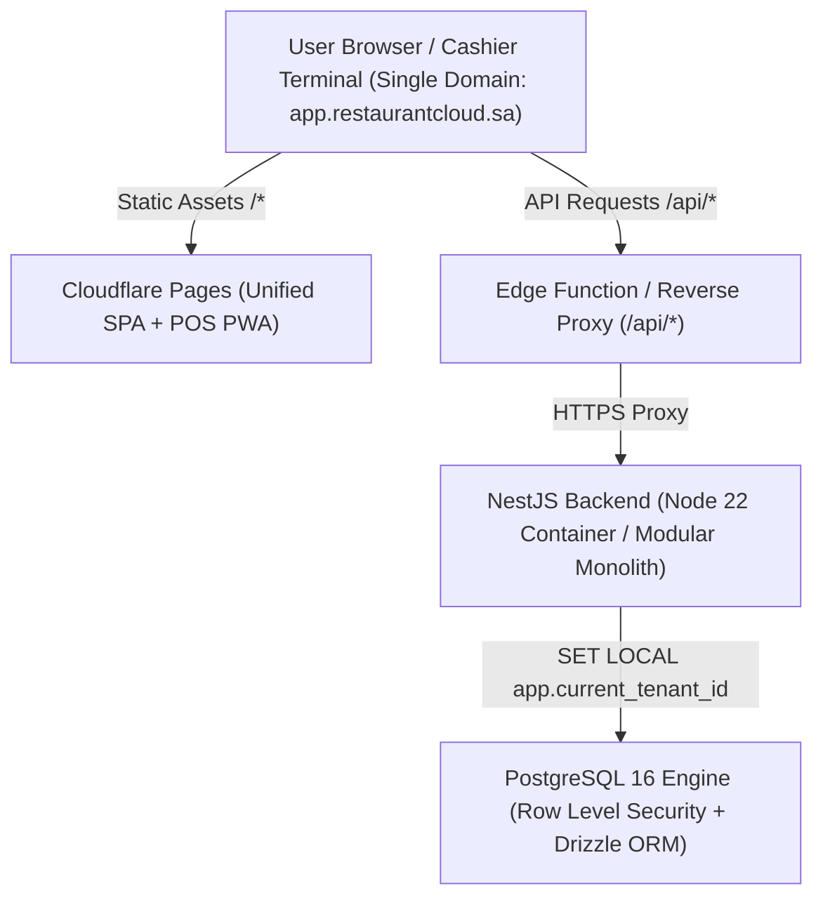
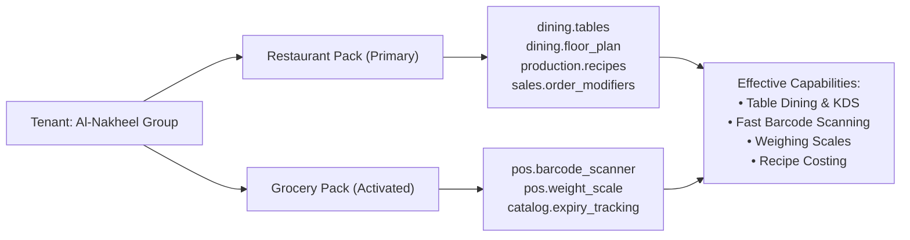

# Restaurant Cloud — Multi-Industry SaaS Architecture Specification

## 1. Executive Summary & Product Vision

Restaurant Cloud is an enterprise-grade, Multi-Tenant, Multi-Industry Software-as-a-Service (SaaS) platform built for retail and hospitality businesses in Saudi Arabia and the GCC region. Similar to leading cloud accounting platforms like **Qoyod (قيود)**, Restaurant Cloud provides an integrated, unified SaaS experience where business owners manage their entire operation through **a single web portal under a single domain (`app.restaurantcloud.sa`)**.

Rather than distributing disjointed, siloed applications for restaurants, supermarkets, bakeries, and cafes, Restaurant Cloud is structured around a **Shared Core ERP Engine** enriched by dynamic, composable **Industry Packs**. A single tenant account can activate multiple industry packs concurrently (for instance, a fine dining restaurant running a retail bakery corner or coffee kiosk) while preserving unified accounting, inventory, tax compliance, and user management.



---

## 2. Core Architectural Pillars

### 2.1 Single Domain & Unified Customer Experience
1. **Unified Entry Point**: Customers access all capabilities through `https://app.restaurantcloud.sa`.
2. **Unified Authentication**: A single login screen (`/login`) issues a cryptographically signed JWT carrying user identity, active tenant membership, and tenant permissions.
3. **Internal Routing**:
   - `/dashboard` — Executive BI metrics, operational KPIs, financial summaries.
   - `/pos` — Cashier Terminal with dedicated Full-Screen mode, keyboard shortcuts, barcode scanner listener, and offline queueing.
   - `/dining` — Visual floor plan and table seating management (Restaurant pack).
   - `/inventory` — Real-time multi-warehouse stock balances, valuation, movements, and transfers.
   - `/production` — Recipe management, recipe costing, and batch production orders.
   - `/purchasing` — Supplier catalog, Purchase Orders, Goods Receipt (GRN), and 3-way matching.
   - `/accounting` — Chart of Accounts, General Ledger, VAT 201 return, and Trial Balance.
   - `/settings/industries` — SaaS Control Plane for activating/deactivating industry packs and viewing active capabilities.

### 2.2 Core ERP Foundation vs. Industry Packs
- **Shared Core ERP**: The immutable financial and operational backbone. All tenants—regardless of industry—rely on double-entry accounting, real-time inventory ledger with FIFO/Weighted Average valuation, ZATCA Phase 2 e-invoicing, tax rules, supplier procurement, user RBAC, and multi-branch/multi-entity hierarchy.
- **Composable Industry Packs**: Discrete capability sets that augment the Core ERP with domain-specific workflows, UI components, and API validations without altering the underlying ledger or schemas.

### 2.3 Strict Tenant Isolation via PostgreSQL 16 RLS
- Multi-tenancy is enforced strictly at the database engine level via PostgreSQL 16 `ROW LEVEL SECURITY` (`FORCE ROW LEVEL SECURITY`).
- All queries run as the non-superuser runtime role `rc_app_user`.
- Before executing any transaction or query, the backend executes `SELECT set_config('app.current_tenant_id', :tenantId, true);`.
- RLS policies ensure zero cross-tenant data leakage across all tables, including newly introduced tables: `tenant_subscriptions` and `tenant_industry_packs`.

---

## 3. Composable Industry Packs Registry

| Industry Pack | Enum Identifier | Primary Target Market | Specialized Capabilities |
| :--- | :--- | :--- | :--- |
| **Restaurants** | `RESTAURANT` | Fine dining, Casual dining, Fast food | Table management, split bills, Kitchen Display System (KDS), recipe yield costing, modifier groups. |
| **Cafes & Coffee** | `CAFE` | Specialty coffee, Drive-thru, Kiosks | Drink sizes (S/M/L), milk/syrup customizations, loyalty points, fast quick-counter checkout. |
| **Grocery & Marts** | `GROCERY` | Supermarkets, Minimarts, Bodegas | Continuous barcode scanning, weighing scale integration, expiration date tracking, batch/lot management. |
| **Bakeries** | `BAKERY` | Pastry shops, Artisan bakeries, Central kitchens | Batch baking recipes, dough mixing yield calculation, daily freshness expiration, production waste tracking. |
| **Catering** | `CATERING` | Event caterers, Corporate meal providers | Event banquet orders, per-person pricing, delivery scheduling, advanced booking deposits. |
| **Retail** | `RETAIL` | Boutiques, Electronics, Gift shops | Matrix products (Size / Color / Variant), serial numbers, customer loyalty, barcode label printing. |

---

## 4. Multi-Industry Union & Capability Aggregation

Tenants are never forced into an exclusive silo. A tenant can activate multiple packs concurrently. When multiple packs are active, the system computes the **mathematical union of discrete capabilities**:

$$\text{Capabilities}_{\text{Tenant}} = \bigcup_{i \in \text{ActivePacks}} \text{Capabilities}(i)$$



### Server-Side Entitlement Guard
Access to specialized domain controllers is gated by the `@RequireCapability(...)` decorator and `IndustryEntitlementGuard`:
```typescript
@Controller('dining')
@UseGuards(JwtAuthGuard, IndustryEntitlementGuard)
@RequireCapability('dining.tables')
export class DiningController { ... }
```
If a tenant invokes an endpoint without possessing the requisite capability, the guard rejects the request with HTTP `403 Forbidden`:
```json
{
  "statusCode": 403,
  "message": "Access denied. Your active industry subscription does not include capability: 'dining.tables'. Please activate the required Industry Pack in Settings.",
  "error": "Forbidden"
}
```

---

## 5. Non-Destructive Lifecycle & Data Preservation

1. **Pack Activation**: Setting an industry pack to `ACTIVE` immediately unlocks its UI tabs and API endpoints.
2. **Pack Deactivation**: Setting an industry pack to `INACTIVE` hides its UI entry points and revokes capability entitlements. **No tenant data (products, recipes, orders, inventory logs) is deleted**.
3. **Reactivation**: Re-enabling the pack immediately restores access to all previous data and configuration.

---

## 6. Security & Auditability

All industry pack activations, deactivations, and plan changes are immutably recorded in the `audit_logs` table with:
- Tenant ID and Actor User ID.
- Action name (`INDUSTRY_PACK_ACTIVATED`, `INDUSTRY_PACK_DEACTIVATED`, `SUBSCRIPTION_UPDATED`).
- Timestamp and previous/updated state payload.
