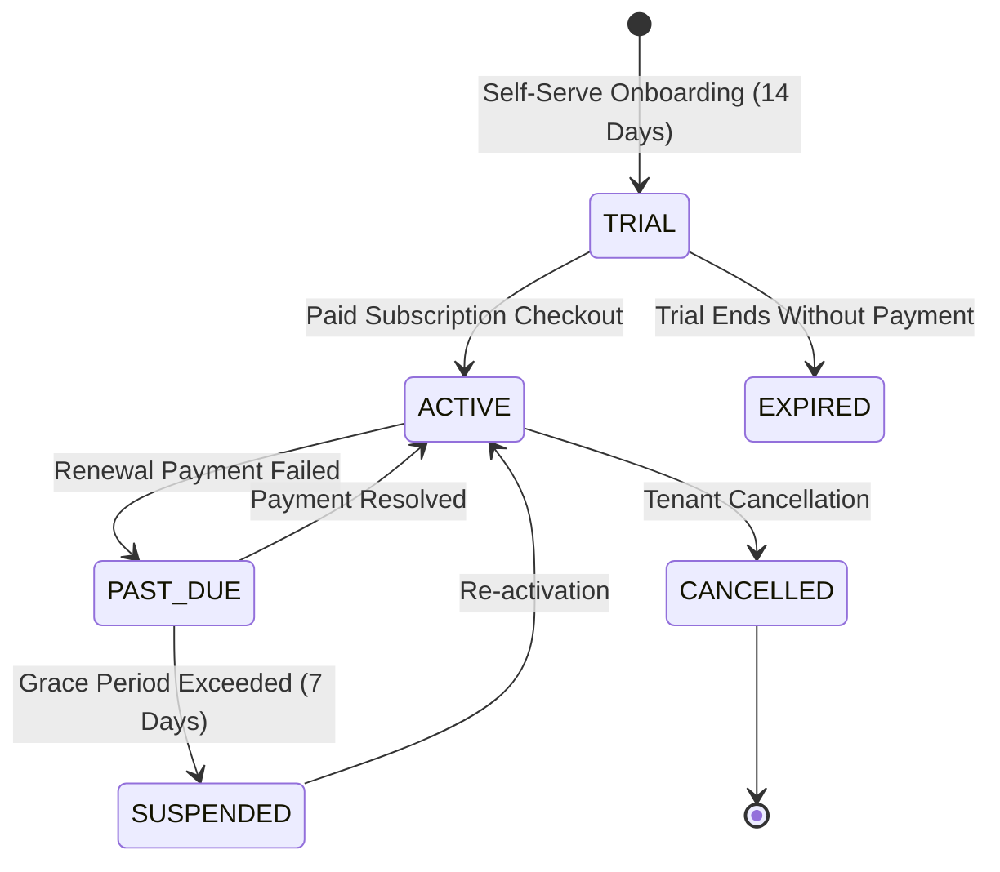

# SaaS Control Plane & Subscription Entitlements

## 1. Overview & Subscription Lifecycle

The **SaaS Control Plane** governs tenant onboarding, license quotas, billing tiers, and industry pack entitlement enforcement throughout the customer journey.



---

## 2. Subscription Plans & Quota Tiers

| Plan Tier | Plan Code | Max Branches | Max Devices | Max Users | Included Industry Packs | Target Customer |
| :--- | :--- | :---: | :---: | :---: | :---: | :--- |
| **Free Trial** | `FREE_TRIAL` | 3 | 5 | 10 | 1 (Primary) | New customers evaluating the system (14 days). |
| **Starter** | `STARTER` | 1 | 2 | 3 | 1 | Single-location boutique cafes or food trucks. |
| **Growth** | `GROWTH` | 5 | 15 | 25 | Up to 3 | Multi-branch restaurants or expanding supermarket branches. |
| **Enterprise** | `ENTERPRISE` | Unlimited | Unlimited | Unlimited | Unlimited (All 6) | National food chains, franchise groups, and commercial bakeries. |
| **Custom** | `CUSTOM` | Custom | Custom | Custom | Custom | Specialized enterprise contracts. |

---

## 3. Onboarding & Provisioning Flow

When a new organization signs up:
1. **Tenant Provisioning**: The system creates a `tenants` record and default `groups` container.
2. **Initial Legal Entity & Branch**: Generates the primary `legal_entities` record (with CR & VAT) and primary operational `branches` and `warehouses`.
3. **Admin User & Scoped Role**: Creates the initial administrator user with `TENANT` scope and owner permissions.
4. **Trial Subscription**: Automatically grants a 14-day `FREE_TRIAL` subscription in `tenant_subscriptions`.
5. **Primary Industry Pack**: Activates the selected primary industry pack (`RESTAURANT`, `CAFE`, etc.) in `tenant_industry_packs`.
6. **Immutable Audit Trail**: Logs a `TENANT_ONBOARDED` audit event.

---

## 4. In-App Control Plane API Endpoints

The SaaS Control Plane exposes dedicated management APIs under `/tenants`:

### 4.1 Get Active Industry Packs & Capabilities
- **Endpoint**: `GET /api/v1/tenants/industries`
- **Response**:
```json
{
  "activeIndustries": ["RESTAURANT", "GROCERY"],
  "capabilities": [
    "dining.tables",
    "dining.floor_plan",
    "production.recipes",
    "production.kitchen_kds",
    "inventory.recipe_costing",
    "sales.order_modifiers",
    "pos.dine_in",
    "pos.barcode_scanner",
    "pos.weight_scale",
    "catalog.expiry_tracking",
    "catalog.batch_numbers",
    "inventory.retail_packaging",
    "inventory.fast_replenishment"
  ],
  "packs": [
    {
      "id": "uuid",
      "industry": "RESTAURANT",
      "status": "ACTIVE",
      "isPrimary": true,
      "activatedAt": "2026-11-08T00:00:00Z"
    },
    {
      "id": "uuid",
      "industry": "GROCERY",
      "status": "ACTIVE",
      "isPrimary": false,
      "activatedAt": "2026-11-08T01:00:00Z"
    }
  ]
}
```

### 4.2 Activate an Industry Pack
- **Endpoint**: `POST /api/v1/tenants/industries/activate`
- **Request Body**:
```json
{
  "industry": "GROCERY",
  "settings": {
    "continuousScanning": true,
    "scaleWeightPrefix": "21"
  }
}
```

### 4.3 Deactivate an Industry Pack
- **Endpoint**: `POST /api/v1/tenants/industries/deactivate`
- **Request Body**:
```json
{
  "industry": "GROCERY",
  "reason": "Seasonal corner closed"
}
```
*Note: Deactivation is non-destructive. Existing products, stock records, and invoices remain intact.*

### 4.4 Get SaaS Subscription & Quotas
- **Endpoint**: `GET /api/v1/tenants/subscription`
- **Response**:
```json
{
  "planCode": "GROWTH",
  "status": "ACTIVE",
  "billingInterval": "MONTHLY",
  "maxBranches": 5,
  "maxDevices": 15,
  "maxUsers": 25,
  "renewsAt": "2026-12-08T00:00:00Z"
}
```

---

## 5. UI Control Plane Experience

In the unified web dashboard (`apps/web`), tenant administrators access the **Industry Packs & Capabilities Center** (`/settings/industries`):
- **Live Capability Badges**: Displays currently unlocked operational modules with visual counters.
- **One-Click Activation**: Easily toggle industry packs with real-time capability matrix updates.
- **Dynamic Navigation Filtering**: The main sidebar navigation menu instantly filters modules (e.g. Dining Floor Plan is displayed only if `RESTAURANT` is active; Barcode Scanner settings appear only if `GROCERY` or `RETAIL` is active).
