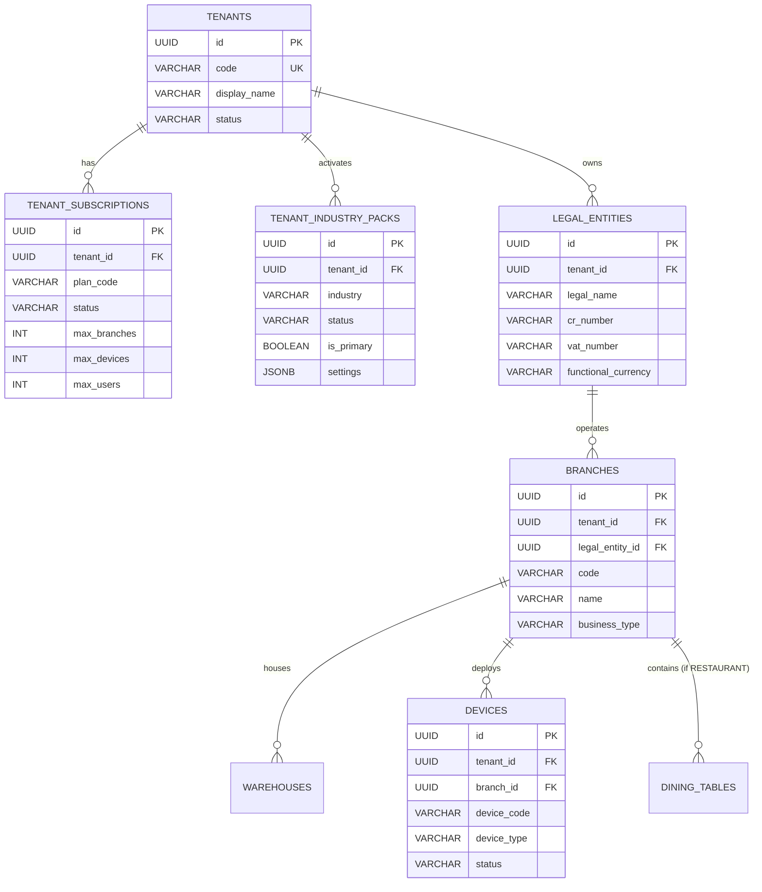

# Tenant, Industry, and Organizational Entity Model

## 1. Relational Hierarchy & Guiding Principles

A foundational principle of Restaurant Cloud is the **clean separation between the SaaS Account (Tenant), the Business Domain (Industry Pack), the Fiscal/Tax Boundary (Legal Entity), and the Physical Location (Branch/Warehouse/Device)**.



---

## 2. Invariant Model Rules

1. **Activating an Industry Pack DOES NOT create a new Legal Entity or Tenant**:
   - Industry Packs are feature and capability flags attached directly to `tenants`.
   - Activating `GROCERY` on a `RESTAURANT` tenant enables grocery workflows within the existing account without spinning up a separate tenant ID or forcing users to log into a separate portal.

2. **Adding a Legal Entity DOES NOT alter Industry Pack entitlements**:
   - A business group with multiple commercial registrations (e.g. Al-Nakheel Dining LLC and Al-Nakheel Catering LLC) registers multiple `legal_entities` under the **same tenant**.
   - All legal entities share the tenant's activated industry capabilities, Chart of Accounts framework, and consolidated reporting while maintaining distinct VAT numbers and tax filings.

3. **Branches and Warehouses operate under a single Legal Entity**:
   - Each `branch` must belong to exactly one `legal_entity` for tax compliance (ZATCA Phase 2 requires invoice attribution to the branch's legal entity CR and VAT registration).
   - Warehouses belong to a branch (or group) and are scoped strictly under the same tenant.

4. **POS Devices belong to a Branch**:
   - Each POS cash register or tablet is registered as a `device` under a specific `branch`.
   - The device inherits the branch's legal entity for invoice sequence and tax calculation, and inherits the tenant's active industry capabilities for POS screen features.

---

## 3. Database Schema Implementation

```sql
-- 1. SaaS Subscriptions
CREATE TABLE tenant_subscriptions (
    id UUID PRIMARY KEY DEFAULT gen_random_uuid(),
    tenant_id UUID NOT NULL REFERENCES tenants(id) ON DELETE CASCADE,
    plan_code VARCHAR(50) NOT NULL DEFAULT 'FREE_TRIAL',
    status VARCHAR(50) NOT NULL DEFAULT 'TRIAL',
    billing_interval VARCHAR(20) NOT NULL DEFAULT 'MONTHLY',
    max_branches INT NOT NULL DEFAULT 3,
    max_devices INT NOT NULL DEFAULT 5,
    max_users INT NOT NULL DEFAULT 10,
    trial_ends_at TIMESTAMPTZ,
    renews_at TIMESTAMPTZ,
    created_at TIMESTAMPTZ NOT NULL DEFAULT NOW(),
    updated_at TIMESTAMPTZ NOT NULL DEFAULT NOW(),
    CONSTRAINT uq_tenant_subscription UNIQUE (tenant_id)
);

-- 2. Tenant Industry Packs
CREATE TABLE tenant_industry_packs (
    id UUID PRIMARY KEY DEFAULT gen_random_uuid(),
    tenant_id UUID NOT NULL REFERENCES tenants(id) ON DELETE CASCADE,
    industry VARCHAR(50) NOT NULL, -- RESTAURANT, CAFE, GROCERY, BAKERY, CATERING, RETAIL
    status VARCHAR(50) NOT NULL DEFAULT 'ACTIVE', -- ACTIVE, INACTIVE, SUSPENDED
    is_primary BOOLEAN NOT NULL DEFAULT FALSE,
    settings JSONB,
    activated_at TIMESTAMPTZ NOT NULL DEFAULT NOW(),
    deactivated_at TIMESTAMPTZ,
    created_at TIMESTAMPTZ NOT NULL DEFAULT NOW(),
    updated_at TIMESTAMPTZ NOT NULL DEFAULT NOW(),
    CONSTRAINT uq_tenant_industry UNIQUE (tenant_id, industry)
);
```

---

## 4. Query Isolation & Context Propagation

In all transactional queries, the database session context is established with:
```sql
SELECT set_config('app.current_tenant_id', $1, true);
```
Under PostgreSQL Row-Level Security:
- `tenant_subscriptions` checks `tenant_id = current_setting('app.current_tenant_id')::UUID`.
- `tenant_industry_packs` checks `tenant_id = current_setting('app.current_tenant_id')::UUID`.
- `legal_entities`, `branches`, `devices`, `sales_orders`, and `inventory_movements` verify tenant ownership identically.

Cross-tenant queries are blocked unconditionally by the database engine.
