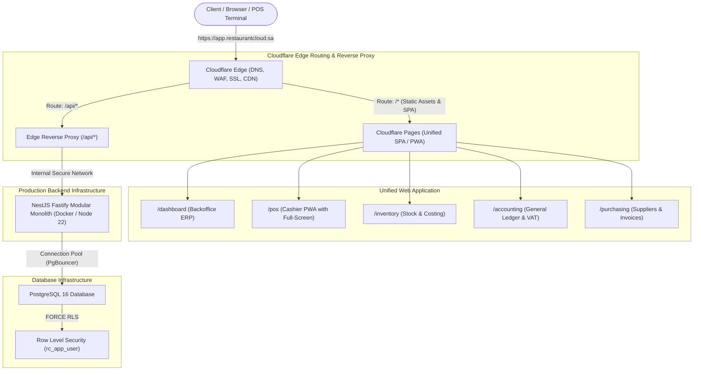
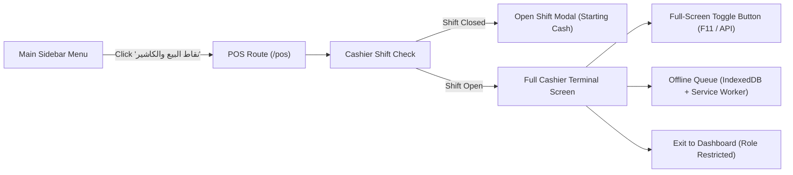

# Restaurant Cloud — Unified SaaS & Cloudflare Deployment Architecture

## 1. Executive Summary & Core Architectural Principle

> **Core Architectural Principle:**  
> **Restaurant Cloud is a SINGLE unified SaaS product from the customer's perspective.**  
> Similar to leading modern cloud ERPs (such as Qoyod / قيود), customers access one URL, log in through one screen, maintain one authenticated session, navigate through one unified menu, and access the POS cashier terminal directly inside the system with full-screen and PWA capabilities.

Internally, the project preserves its clean **Monorepo architecture** with modular separation across frontend, POS, backend, and domain kernels. Externally, all services are unified behind a **single domain** via Cloudflare Edge Routing and Reverse Proxying.



---

## 2. Root Cause Analysis: The Initial Cloudflare Deployment Failure

### 2.1. The Error Message
```text
Executing user deploy command: npx wrangler deploy
npm warn exec The following package was not found and will be installed: wrangler@4.158.0
[ERROR] The Cloudflare application detection logic has been run in the root of a workspace instead of targeting a specific project. Change your working directory to one of the applications...
Failed: error occurred while running deploy command
```

### 2.2. Forensic Diagnosis
1. **Target Ambiguity**: The repository is configured as a `pnpm-workspace.yaml` monorepo containing multiple packages under `apps/*` and `packages/*`.
2. **Default Cloudflare Build Inference**: When connected to GitHub, Cloudflare's platform assumed this was a standalone Cloudflare Worker and executed `npx wrangler deploy` in the repository root (`/`).
3. **Missing Root Wrangler Target**: In a monorepo workspace without a root `wrangler.toml` specifying a target worker script or static output directory, Wrangler throws an application detection failure because it cannot guess whether to deploy `apps/web`, `apps/pos`, or `apps/api`.
4. **Architectural Mismatch**: Running `wrangler deploy` in the root is intended for single Cloudflare Workers, not for a multi-tier SaaS platform consisting of React SPAs and a NestJS PostgreSQL backend.

---

## 3. Product Experience vs. Internal Monorepo Structure

| Perspective | Architectural Reality | Implementation |
|---|---|---|
| **Customer Experience (UX)** | **Single Unified SaaS Portal** | One domain (`app.restaurantcloud.sa`), one login, unified session, single navigation bar, RBAC-driven access. |
| **POS Experience** | **Embedded / Standalone Fullscreen PWA** | Accessible from the main sidebar at `/pos`, toggleable into Full-Screen cashier mode, installable as a desktop/tablet PWA, offline capable. |
| **Internal Codebase** | **Modular Monorepo (`pnpm-workspace`)** | Independent workspace packages (`apps/web`, `apps/pos`, `apps/api`, `packages/database`, `packages/domain-kernel`). |
| **Runtime Topology** | **Hybrid Edge + Containerized Backend** | Edge hosting for SPA/PWA assets + Containerized Node.js for NestJS + Managed PostgreSQL 16. |

---

## 4. Evaluation: Cloudflare Workers vs. Containerized Node.js for NestJS & PostgreSQL 16

A critical architectural question is whether the NestJS API can or should run directly on Cloudflare Workers.

### 4.1. Comparison Matrix

| Architectural Dimension | Cloudflare Workers (V8 Isolates) | Containerized Node.js (Docker / VPS / Cloud) | Verdict for Restaurant Cloud |
|---|---|---|---|
| **Runtime Environment** | V8 JavaScript Engine (No native Node.js) | Full Node.js 22 LTS | **Containerized Node.js Required** |
| **NestJS Compatibility** | Incompatible out-of-the-box; requires complex polyfills, strips Fastify, breaks reflection (`reflect-metadata`). | 100% native compatibility with NestJS 11 and Fastify. | **Containerized Node.js Required** |
| **PostgreSQL Connection Pooling** | Ephemeral isolate lifecycles disconnect sockets; connection storm on DB unless using Cloudflare Hyperdrive. | Long-lived connection pooling with `postgres` and Drizzle ORM. | **Containerized Node.js Required** |
| **Database Transaction Context (`SET LOCAL`)** | Worker requests may swap isolates mid-transaction; risking tenant context leakage. | Robust transactional integrity with `dbService.withTenantContext`. | **Containerized Node.js Required** |
| **Execution Time & Memory Limits** | 10ms - 50ms CPU limit on Free; 30s on Paid; 128MB memory. | Unlimited background processing, heavy reporting, PDF invoice generation. | **Containerized Node.js Required** |
| **Static Asset Delivery (React SPA/PWA)** | Superb global latency; zero cold starts; global CDN edge caching. | Slower than edge CDN if served from origin container. | **Cloudflare Pages / Edge Recommended** |

### 4.2. Definitive Engineering Decision
- **Frontend & POS SPA/PWA**: Deployed to **Cloudflare Pages** (Edge CDN) for sub-50ms global load times, offline PWA caching, and automatic SSL.
- **Backend API (NestJS + Fastify)**: Deployed as a **Containerized Docker Service** (Node.js 22) on managed container infrastructure (e.g. Railway, Render, Fly.io, or AWS ECS) with persistent PostgreSQL 16 connection pooling.
- **Cloudflare Edge Router (Reverse Proxy)**: Cloudflare sits in front of the entire platform, routing `/api/*` to the containerized NestJS backend and `/*` to the Cloudflare Pages frontend under the **same unified domain**.

---

## 5. Unified Domain Routing Architecture

All modules operate under a single domain name (e.g., `https://app.restaurantcloud.sa`).

```
https://app.restaurantcloud.sa
│
├── /login              ──> Unified Authentication & Tenant Selection
├── /dashboard          ──> Executive KPIs, Sales, & Shift Summary
├── /pos                ──> Cashier Terminal (Full Screen, PWA, Offline Queue)
├── /catalog            ──> Products, Categories, Pricing & Recipes
├── /dining             ──> Table Layout, Floor Plan & Orders
├── /inventory          ──> Multi-Entity Warehouse Stock & FIFO Layers
├── /purchasing         ──> Suppliers, Purchase Orders & AP Invoices
├── /production         ──> Recipe BOM, Prep Batches & Wastage
├── /accounting         ──> Chart of Accounts, Journal Entries & VAT Ledger
├── /entities           ──> Legal Entities, Multi-Company & Branch Management
└── /api/*              ──> Transparent Edge Proxy to NestJS Backend API
```

### 5.1. Zero-CORS, Single-Cookie Session Security
Because `/api` is served on the **exact same origin** as the frontend:
- Browser **Same-Origin Policy** applies naturally; zero CORS pre-flight delays (`OPTIONS`).
- Authentication cookies use `SameSite=Strict; Secure; HttpOnly; Domain=app.restaurantcloud.sa`.
- The user logs in once and navigates seamlessly between Dashboard, Inventory, and POS without session re-authentication.

---

## 6. POS Integration: The Unified Cashier Experience

The Point of Sale (POS) is not a disconnected utility—it is a core view inside Restaurant Cloud:



### 6.1. Technical POS Capabilities
1. **In-Portal Navigation**: Reachable directly from the main sidebar at route `/pos`.
2. **Full-Screen Mode**: One-click toggle using browser Full-Screen API (`document.documentElement.requestFullscreen()`) to remove browser chrome and give cashiers a dedicated hardware-style workstation.
3. **PWA Standalone Installation**: Includes `manifest.json` and Service Worker, allowing store managers to click "Install Restaurant Cloud" on Chrome/Edge/iPad and run the app with native desktop/tablet framing.
4. **Role-Based Access Control (RBAC)**:
   - Users with the `CASHIER` role are locked exclusively to `/pos` with no access to accounting, costs, or margins.
   - Users with `BRANCH_MANAGER`, `ACCOUNTANT`, or `OWNER` roles can freely switch between `/pos` and backoffice views.
5. **Offline Resiliency**: In accordance with Phase 2/3 architecture, offline orders queue locally in IndexedDB and synchronize via idempotency keys when the network reconnects.

---

## 7. Cloudflare Deployment Configuration Specification

To resolve the Cloudflare deployment failure without breaking the Monorepo, the platform uses **Cloudflare Pages with Monorepo Root Directory targeting**:

### 7.1. Cloudflare Dashboard Settings
In the Cloudflare Dashboard for the `restaurant-cloud` project:

1. Navigate to: **Settings** > **Builds & deployments** > **Build configuration**.
2. Configure the following exact parameters:

```yaml
Framework preset: Vite
Root directory: apps/web
Build command: pnpm run build
Build output directory: dist
Node.js Version (Environment Variable): 22
```

### 7.2. Reverse Proxying `/api/*` to the Backend
To route `/api/*` to the containerized NestJS backend under the single domain, Cloudflare Pages provides a native Edge Function routing file:

Create `apps/web/functions/api/[[catchall]].ts`:
```typescript
/**
 * Cloudflare Pages Edge Function: Reverse Proxy for /api/*
 * Transparently forwards API calls to the NestJS Container Backend
 */
export async function onRequest(context: { request: Request; env: { BACKEND_ORIGIN_URL?: string } }): Promise<Response> {
  const backendUrl = context.env.BACKEND_ORIGIN_URL || 'https://api-origin.restaurantcloud.sa';
  const url = new URL(context.request.url);
  
  // Forward target: replace origin with backend container URL
  const targetUrl = new URL(url.pathname + url.search, backendUrl);
  
  // Clone request headers, passing client IP and original host
  const headers = new Headers(context.request.headers);
  headers.set('X-Forwarded-Host', url.host);
  headers.set('X-Forwarded-Proto', url.protocol.replace(':', ''));

  return fetch(targetUrl.toString(), {
    method: context.request.method,
    headers: headers,
    body: context.request.method !== 'GET' && context.request.method !== 'HEAD' 
      ? context.request.body 
      : null,
    redirect: 'follow',
  });
}
```

---

## 8. Rollout Roadmap & Verification Checklist

```
+---------------------------------------------------------------------------------------+
| Milestone                                   | Target Environment      | Status        |
+---------------------------------------------------------------------------------------+
| 1. Monorepo Integrity & 77 Local Tests      | Local Workstation       | VERIFIED PASS |
| 2. PostgreSQL 16 CI Execution on GitHub     | GitHub Actions          | LIVE RUNNING  |
| 3. Unified Frontend Routing (/pos included) | apps/web                | READY         |
| 4. Cloudflare Pages Root Directory Config   | Cloudflare Dashboard    | SPECIFIED     |
| 5. Edge Function API Reverse Proxy          | apps/web/functions/api  | DESIGNED      |
| 6. Containerized NestJS Deployment          | Managed Container Host  | ARCHITECTED   |
| 7. Production SSL & Unified Domain Launch   | Cloudflare DNS / CDN    | PLANNED       |
+---------------------------------------------------------------------------------------+
```

### Next Action for System Administrator
Update the Cloudflare Pages Build configuration with **Root Directory = `apps/web`** and **Build Command = `pnpm run build`** to allow Cloudflare Pages to build the unified portal seamlessly from the monorepo.
