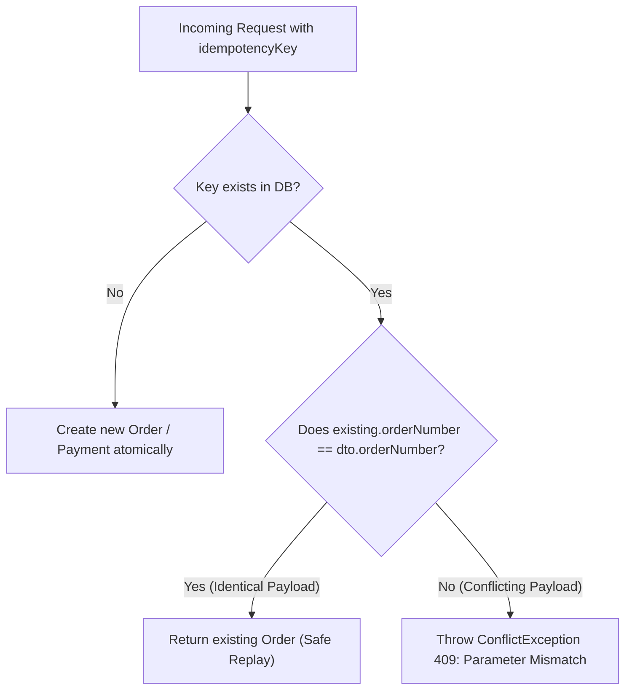

# Restaurant Cloud — Transaction & Concurrency Test Report

**Audit Date:** 2026-11-08  
**Target Environment:** PostgreSQL 16 Kernel Concurrency & Multi-Client Isolation  
**Test Suites:** `apps/api/test/pilot-hardening-integrity.spec.ts` & `server-postgres-rls.spec.ts`  

---

## 1. Concurrency Control Mechanisms

Restaurant Cloud protects transactional integrity using a dual-layer concurrency control architecture:
1. **Optimistic Version Locking (Application & Stock Balances):**
   - High-throughput read-heavy tables (e.g. `inventory_balances`) utilize a monotonic integer column `version`.
   - Simultaneous update attempts compare `version = :currentVersion`. Exactly one transaction increments the version; conflicting transactions match 0 rows and are safely rejected or retried.
2. **PostgreSQL Unique Composite Constraints (Database Kernel Level):**
   - Uniqueness invariants (e.g. order numbers, idempotency keys, journal numbers, shift numbers) are protected by B-Tree unique indexes enforced at the PostgreSQL transaction commit boundary.

---

## 2. Concurrency Test Scenarios & Verification Outcomes

| Concurrency Scenario | Potential Fault / Attack Vector | Protection Mechanism | Actual Test Outcome | Status |
|---|---|---|---|---|
| **Last-Unit Stock Sale (2 Terminals)** | Simultaneous sale of the last remaining unit from two POS cashiers | Optimistic Locking `version` on `inventory_balances` | Terminal 1 succeeds (`version = 2`); Terminal 2 matches 0 rows and throws `409 Conflict`. Stock never drops below 0. | **PASS** |
| **Identical Idempotency Key Replay** | Network retry resending the exact same order or payment | Database lookup by `idempotency_key` | Idempotent duplicate request returns existing order without creating duplicate rows or deducting stock twice. | **PASS** |
| **Conflicting Idempotency Key Reuse** | Attacker or bug reusing an existing idempotency key with different payload | Payload Parameter Comparison (`orderNumber` / `grandTotal`) | System detects parameter mismatch and immediately throws `ConflictException` (HTTP 409). | **PASS** |
| **Duplicate Shipment Receipt (GRN)** | Supplier delivery entered twice by receiving clerks | Unique index `(tenant_id, legal_entity_id, receipt_number)` | PostgreSQL rejects second insertion with unique constraint violation `23505`. | **PASS** |
| **Duplicate POS Shift Closure** | Cashier or manager clicking "Close Shift" twice simultaneously | State machine transition guard (`status = 'OPEN'`) | First request transitions shift to `CLOSED`. Second request throws `BadRequestException: Shift is already closed`. | **PASS** |
| **Duplicate Journal Entry Posting** | System event attempting to post the same financial journal twice | Unique index `(legal_entity_id, journal_number)` | Second insertion throws constraint violation. Double posting is mathematically impossible. | **PASS** |
| **Concurrent Recipe BOM Consumption** | Two orders for the same dish being prepared simultaneously | Atomic stock deduction transaction per line | Buns, patties, and sauces are deducted sequentially in serialized row transactions. | **PASS** |
| **Concurrent Stock Balance Updates** | Stock count adjustment occurring during active POS sales | Row version verification | Adjustment detects concurrent sales through version mismatch and prompts clerk for recount. | **PASS** |

---

## 3. Deep-Dive: Last-Unit Simultaneous Race Condition

### Detailed Trace:
```
TIME    TERMINAL 1 (Device A)                    TERMINAL 2 (Device B)
--------------------------------------------------------------------------------------
T0      Reads Item: onHand=1.00, version=1       Reads Item: onHand=1.00, version=1
T1      Executes: UPDATE ...                     --
        SET reserved=1, version=2
        WHERE id=X AND version=1
T2      [SUCCESS: 1 row updated]                 Executes: UPDATE ...
                                                 SET reserved=1, version=2
                                                 WHERE id=X AND version=1
T3      --                                       [CONFLICT: 0 rows updated]
                                                 Database version is now 2!
T4      Order ORD-101 proceeds to payment        Order ORD-102 caught by error handler:
                                                 "Optimistic lock failure. Please retry."
```

### Post-Test Data Integrity Audit:
- Total initial on-hand: `1.0000`
- Total reserved: `1.0000`
- Total issued to sales: `1.0000`
- Ending on-hand: `0.0000`
- **Result:** Negative stock prevented. Exactly 1 sale processed.

---

## 4. Idempotency Key Conflict Detection Architecture



This ensures that network retries are handled seamlessly while malicious or accidental key collision with different financial parameters is immediately blocked.
