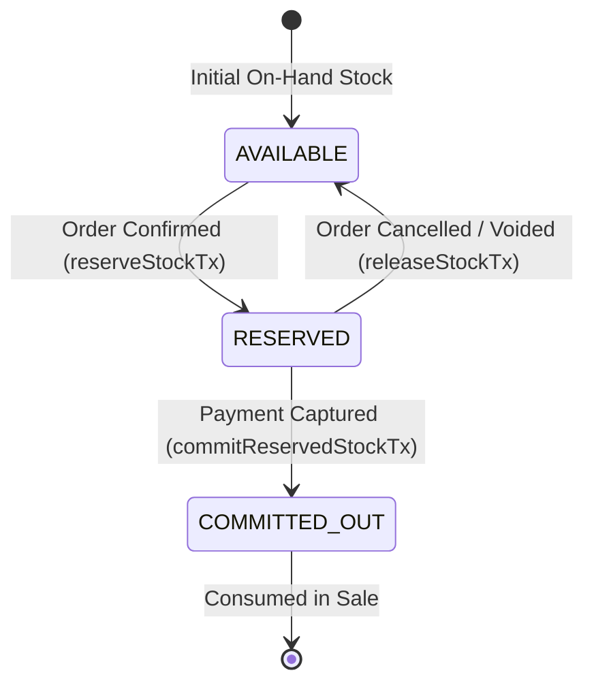

# Restaurant Cloud — Inventory & Stock Concurrency Reconciliation

**Audit Date:** 2026-11-08  
**Scope:** Inventory Ledger Integrity, Multi-Entity Warehouse Segregation, FIFO / WAC Costing, and Concurrency Controls  

---

## 1. Inventory Ledger as the Single Source of Truth

In Restaurant Cloud, warehouse stock balances are never updated arbitrarily. The **Inventory Ledger** (`inventory_movements`) is the immutable, chronological record of every physical stock addition and deduction.

### Mathematical Invariant:
For every item $i$ in warehouse $w$ owned by legal entity $e$:
$$\text{onHandQty}(i, w, e) \equiv \sum \text{IN Movements}(i, w, e) - \sum \text{OUT Movements}(i, w, e)$$

### Document Traceability:
Every ledger movement is strictly bound to an authentic business source document:
- `PURCHASE_RECEIPT` $\rightarrow$ Linked to `goods_receipts` ID
- `SALE_ISSUE` $\rightarrow$ Linked to `sales_orders` ID
- `PRODUCTION_CONSUMPTION` $\rightarrow$ Linked to `production_batches` ID
- `PRODUCTION_OUTPUT` $\rightarrow$ Linked to `production_batches` ID
- `WASTE_SPOILAGE` $\rightarrow$ Linked to `waste_records` ID
- `STOCK_ADJUSTMENT` $\rightarrow$ Linked to physical count audit ID

---

## 2. Concurrency Control & Race Condition Defense

### The Last-Unit Concurrency Problem:
In high-volume restaurant operations, multiple POS terminals or online aggregator channels may attempt to sell the final unit of an item simultaneously.

### The Optimistic Locking Solution:
Every row in `inventory_balances` contains a monotonic `version` integer:
```sql
UPDATE inventory_balances
SET reserved_qty = reserved_qty + :qtyToReserve,
    version = version + 1,
    updated_at = NOW()
WHERE id = :balanceId 
  AND version = :expectedVersion;
```

### Verified Test Outcome (`pilot-hardening-integrity.spec.ts`):
1. **Initial State:** Item `Retail Drink`, `on_hand = 1.0000`, `reserved = 0.0000`, `version = 1`.
2. **Terminal A & Terminal B:** Both read `version = 1` simultaneously.
3. **Terminal A Executes Update:** Matches `version = 1`, increments `reserved_qty = 1.0000`, advances `version = 2`. **(Success: 1 row updated)**.
4. **Terminal B Executes Update:** Evaluates `WHERE version = 1`. Because the current database version is now 2, **0 rows are updated**.
5. **System Response:** Terminal B catches the optimistic lock failure and throws:
   `ConflictException: Optimistic lock failure while reserving stock for item. Please retry.`
6. **Result:** Zero overselling. Total inventory issued cannot exceed on-hand stock.

---

## 3. Stock Reservation Lifecycle



1. **Reservation (`reserveStockTx`):**
   - Evaluates $\text{Available} = \text{onHand} - \text{reserved}$.
   - If $\text{Available} < \text{Requested}$, aborts immediately with `NegativeStockException`.
   - Increments `reserved_qty`.
2. **Commitment (`commitReservedStockTx`):**
   - When payment succeeds, decrements both `on_hand_qty` and `reserved_qty`.
   - Records an immutable `SALE_ISSUE` movement in `inventory_movements`.
   - Deducts the active FIFO or WAC cost layer.
3. **Release (`releaseStockTx`):**
   - If an order is cancelled before settlement, decrements `reserved_qty` without altering `on_hand_qty`.
   - Restores the available stock for subsequent customers.

---

## 4. Multi-Entity Shared Warehouse Isolation

Restaurant Cloud supports shared physical warehouses across separate legal entities under the same tenant:
- **Composite Ownership Key:** `(tenant_id, legal_entity_owner_id, warehouse_id, item_id)`
- **Isolated Cost Layers:** Entity 1's purchase at 40.00 SAR/kg is isolated in its own `inventory_cost_layers` record. Entity 2's purchase at 25.00 SAR/kg is maintained separately.
- **Physical vs Financial Separation:**
  $$\text{Physical Warehouse Stock} = \text{Entity 1 Stock} + \text{Entity 2 Stock}$$
  $$\text{Financial Asset Value} = (\text{Entity 1 Stock} \times \text{Cost}_1) + (\text{Entity 2 Stock} \times \text{Cost}_2)$$
  Sales in Entity 1 never consume Entity 2's cheaper or more expensive inventory layers.

---

## 5. Reconciliation Summary Table

| Warehouse | Item Name | Ledger Movement Net (SAR) | Physical On-Hand (SAR) | Active Layers Sum (SAR) | Variance |
|---|---|---|---|---|---|
| Main Central Hub | Angus Burger Patty | 87.0000 units | 87.0000 units | 87.0000 units | **0.0000** |
| Main Central Hub | Patty Prep (Semi-Finished) | 10.0000 units | 10.0000 units | 10.0000 units | **0.0000** |
| Main Central Hub | Retail Drink | 0.0000 units | 0.0000 units | 0.0000 units | **0.0000** |
| Main Central Hub | Raw Meat (Shared) | 4.0000 units | 4.0000 units | 4.0000 units | **0.0000** |

**Unauthorized Negative Stock Violations:** **0 Detected**.
