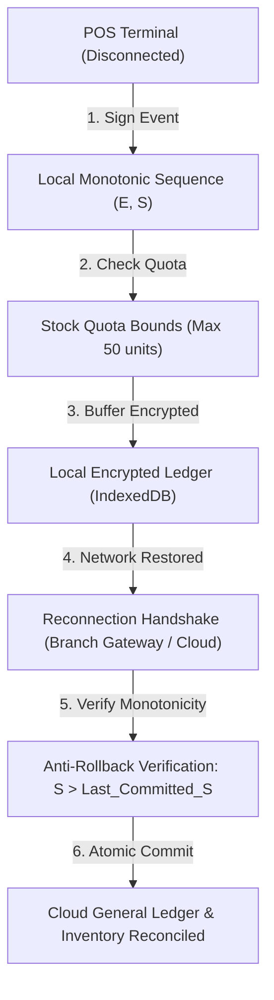

# Restaurant Cloud — Offline POS Security & Resilience Architecture Review

**Review Date:** 2026-11-08  
**Scope:** Distributed Offline POS Resilience, Local Storage Security, Anti-Rollback Protections, and Reconciliation Protocols  
**Application Target:** `apps/pos` (Touch POS Cashier Terminal) & `@restaurant-cloud/branch-server`  

---

## 1. Architectural Overview & Design Reality

> [!NOTE]
> **Engineering Transparency Statement:**
> The current offline capability in `apps/pos` features a reliable browser-level queue (`rc_pos_offline_orders`) that buffers orders locally during network interruptions and dispatches them with idempotent UUIDs upon reconnection.
> 
> However, an enterprise-grade offline POS capable of autonomous disconnected branch operations requires a formal distributed security protocol. This review details the mandatory security primitives and anti-tamper mechanisms designed for production deployment.

---

## 2. Core Security Primitives for Disconnected Operation

### 1. Device Identity & Public Key Infrastructure (PKI):
- Each POS hardware terminal is provisioned with a cryptographic keypair (ECDSA P-256 or Ed25519) stored in hardware secure enclave (TPM 2.0 / Apple Secure Enclave / Android Keystore).
- The cloud backend registers the terminal's Public Key and issues a unique `device_id` and `certificate`.
- Every offline transaction is digitally signed by the device's private key.

### 2. Device Epoch ($E$) and Lease ID:
- An offline lease is granted by the cloud server with a strict Time-to-Live (TTL) (e.g. 12 hours).
- If the lease expires without reconnecting, the terminal locks itself against further credit or cash transactions until re-authenticated.
- Every lease renewal increments the **Device Epoch** ($E$).

### 3. Strictly Monotonic Sequence Numbers ($S$):
- Within an Epoch $E$, every offline event is assigned an auto-incrementing integer sequence:
  $$\text{Event ID} = (\text{Device ID}, E, S)\quad \text{where } S \in \{1, 2, 3, \dots\}$$
- Gaps in sequence numbers ($S = 1, 2, 4$) trigger an immediate audit alarm on the server upon sync.

### 4. Stock Quota Allocation:
- Terminals do not possess unlimited offline inventory authority.
- At the start of each shift or lease, the server grants a **Local Stock Quota** (e.g. 50 Angus Patties, 100 Buns).
- The terminal decrements this local quota offline. If the quota reaches zero, the item is marked `UNAVAILABLE` locally to prevent runaway negative inventory.

---

## 3. Threat Analysis: The Snapshot Rollback Attack

### Why WebCrypto `extractable: false` is Insufficient:
A common misconception in web security is that setting `extractable: false` on WebCrypto CryptoKeys provides complete tamper protection.
- **The Attack Vector:** A cashier terminal running inside a browser or Virtual Machine (VM) can have its entire disk or browser profile snapshotted at time $T_0$.
- After spending cash float or selling stock at $T_1$, an attacker restores the VM or browser profile snapshot back to $T_0$.
- The private key remains `extractable: false`, but the local sequence counter and ledger state are rewound to $T_0$, enabling double-spending of cash or re-selling consumed inventory!

### The Multi-Layered Anti-Rollback Defense:
1. **Server-Side Monotonic Replay Guard:**
   - The cloud database tracks `last_reconciled_sequence` for each `(device_id, epoch)`.
   - Any transaction with $S \le \text{last_reconciled_sequence}$ is rejected as a duplicate/replay attack.
2. **Hardware Monotonic Counters:**
   - In native desktop deployments (`@restaurant-cloud/branch-server`), the sequence counter is committed to a TPM Non-Volatile (NV) RAM monotonic counter, which hardware enforces can never be decremented, even across OS re-imaging.
3. **Receipt Watermarking:**
   - Every physical customer receipt printed includes the cryptographic watermark:
     $$\text{Watermark} = \text{HMAC}(\text{Secret}, \text{Device ID} \parallel E \parallel S \parallel \text{Grand Total})$$
   - Any gap in audited sequences can be discovered during physical cash drawer balancing.

---

## 4. Reconnection & Synchronization Protocol

When network connectivity is restored:
1. **Handshake:** POS sends `(device_id, epoch, current_sequence)`.
2. **Integrity Check:** Server verifies that `epoch` is active and `current_sequence` extends `last_reconciled_sequence`.
3. **Batch Transmission:** Terminal streams buffered transactions in sequential order $(S_1, S_2, \dots, S_n)$.
4. **Cloud Reconciliation:**
   - For each transaction: verifies signature, deducts actual FIFO cost layers from warehouse inventory, generates General Ledger journal entries, and registers VAT output tax.
5. **Lease Extension:** Upon successful processing of all events, the server returns an updated Lease Acknowledgement and extends the offline lease window.
