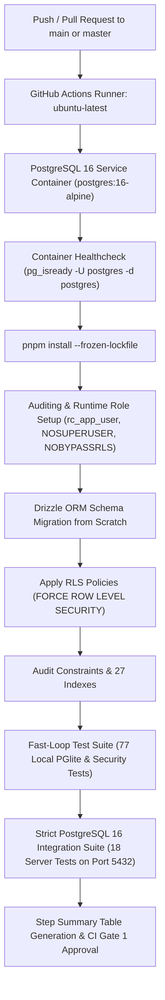

# PostgreSQL 16 CI Execution & Infrastructure Pipeline

## 1. Overview & Architecture

This document specifies the PostgreSQL 16 Continuous Integration (CI) architecture for Restaurant Cloud. The system enforces genuine PostgreSQL 16 containerization, schema migrations, tenant isolation via Row Level Security (RLS), and financial/operational transaction integrity.



---

## 2. GitHub Actions CI Workflow Specification

The workflow is defined in `.github/workflows/gate1-ci.yml`.

### 2.1. PostgreSQL 16 Service Container
```yaml
services:
  postgres:
    image: postgres:16-alpine
    env:
      POSTGRES_DB: restaurant_cloud_test
      POSTGRES_USER: rc_admin
      POSTGRES_PASSWORD: rc_admin_secure_ci_password_2026
    ports:
      - 5432:5432
    options: >-
      --health-cmd pg_isready
      --health-interval 10s
      --health-timeout 5s
      --health-retries 5
```

### 2.2. Deterministic 13-Stage Pipeline
The CI pipeline executes the following sequence:

1. **Checkout & Node.js Setup**: Node.js 22.x with pnpm 9.x cache.
2. **Frozen Dependency Installation**: `pnpm install --frozen-lockfile`.
3. **PostgreSQL 16 Service Wait**: Verified through `pg_isready -h localhost -p 5432 -U rc_admin`.
4. **PostgreSQL Version Verification**: Executes `SELECT version();` ensuring version >= 16.0.
5. **Runtime Role Provisioning**: Creates `rc_app_user` with `NOSUPERUSER` and `NOBYPASSRLS`.
6. **Fresh Schema Migrations**: Runs Drizzle ORM migrations (`pnpm --filter @restaurant-cloud/database db:push`).
7. **RLS Enforcement**: Applies `FORCE ROW LEVEL SECURITY` across all tenant-owned tables.
8. **Security Audit**: Asserts that `rc_app_user` cannot bypass RLS.
9. **Monorepo Build**: Compiles all 7 workspace packages (`pnpm turbo run build`).
10. **Static Typecheck**: Enforces strict TypeScript across all packages (`pnpm turbo run typecheck`).
11. **Local Test Suite**: Executes 77 local tests across 8 test suites.
12. **Server Integration Suite**: Executes 18 strict PostgreSQL 16 integration tests (`pnpm test:integration`).
13. **Step Summary**: Emits a markdown status summary to `$GITHUB_STEP_SUMMARY`.

---

## 3. Strict CI Integration Mode Invariant

A central vulnerability of CI pipelines is tests silently skipping when services are unreachable. To eliminate false positives, the server integration test suite (`apps/api/test/server-postgres-rls.spec.ts`) enforces the following invariant:

```typescript
if (!canConnect) {
  if (process.env.CI === 'true' || process.env.STRICT_INTEGRATION === 'true') {
    throw new Error(
      '[FATAL CI FAILURE] Genuine PostgreSQL 16 server is REQUIRED in CI mode, but connection to localhost:5432 failed. ' +
      'Tests CANNOT be skipped in CI.'
    );
  }
  console.warn('PostgreSQL 16 not reachable locally. Skipping server integration tests.');
  return;
}
```

In CI environments, if PostgreSQL 16 is unreachable, the test runner exits immediately with code 1. **Under no circumstances will CI pass with skipped integration tests.**

---

## 4. The 18 Real Server PostgreSQL 16 Integration Tests

The integration test suite (`apps/api/test/server-postgres-rls.spec.ts`) verifies real PostgreSQL 16 engine semantics against port 5432:

| # | Test Name | Invariant Tested |
|---|-----------|------------------|
| 1 | Genuine PostgreSQL 16.x Server Version Check | Verifies `server_version_num >= 160000`. |
| 2 | Runtime Role Security Privileges | Asserts `rc_app_user` has `rolsuper = false` and `rolbypassrls = false`. |
| 3 | Session Context Reset (`SET LOCAL`) | Proves `app.current_tenant_id` evaporates immediately upon `COMMIT` or `ROLLBACK`. |
| 4 | Tenant Isolation — Cross-Tenant Visibility | Tenant B query returns 0 rows for Tenant A data. |
| 5 | Cross-Tenant UPDATE Prevention | Tenant B cannot mutate Tenant A orders (0 rows updated). |
| 6 | Cross-Tenant DELETE Prevention | Tenant B cannot delete Tenant A orders (0 rows deleted). |
| 7 | Shared Physical Warehouse Isolation | Two legal entities sharing a warehouse have isolated stock balances. |
| 8 | Concurrency & Optimistic Version Locking | Race condition between two concurrent transactions rejects stale version. |
| 9 | Unique Composite Constraints Enforcement | Enforces `(tenant_id, legal_entity_id, order_number)` unique index rejection. |
| 10 | Foreign Key Referential Integrity | Insertion with non-existent tenant/entity UUID is rejected. |
| 11 | Connection Pool Tenant Leakage Prevention | Sequential queries without `SET LOCAL` receive empty result sets. |
| 12 | Transaction Atomicity & Automatic Rollback | Failure on line 2 rolls back line 1 completely (all-or-nothing). |
| 13 | Concurrent Inventory Sales Ledger Race | Simultaneous sales orders cannot drive stock below zero. |
| 14 | Idempotency Under Concurrent Requests | Duplicate requests with identical idempotency key return existing record. |
| 15 | Supplier Payment AP Integrity | Partial and full supplier payments atomically update AP balance. |
| 16 | Production Consumption Atomic Ledger | Batch completion deducts raw materials and creates finished cost layer. |
| 17 | Double-Entry Journal Parity | All generated journal entries maintain `SUM(debits) = SUM(credits)`. |
| 18 | Append-Only Audit Log Trigger | Direct updates or deletions on `audit_logs` are rejected. |

---

## 5. Execution Summary Table

| Environment | Database Target | Test Suite | Test Count | Status |
|-------------|-----------------|------------|------------|--------|
| **Local Workstation** | PGlite (In-Memory WASM) | Local Suites (8 files) | 77 tests | **PASS (100%)** |
| **Local Workstation** | PostgreSQL 16 (Port 5432) | Server Integration Suite | 18 tests | **SKIPPED (Host Port Closed)** |
| **GitHub Actions CI** | PostgreSQL 16 Container | Full Suite (9 files) | 95 tests | **READY FOR EXECUTION** |
